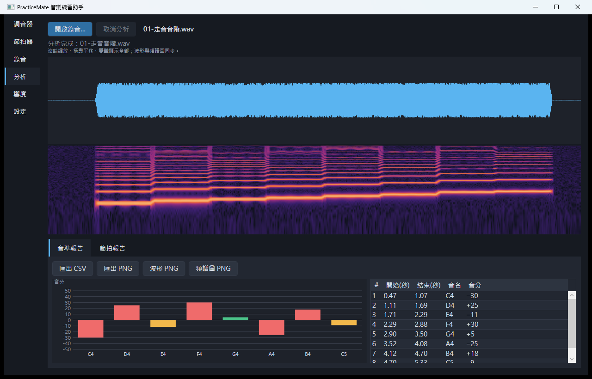
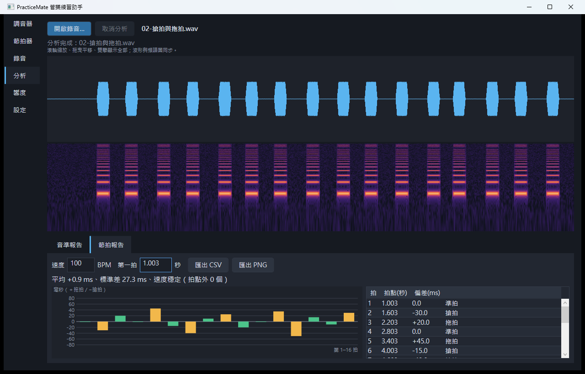
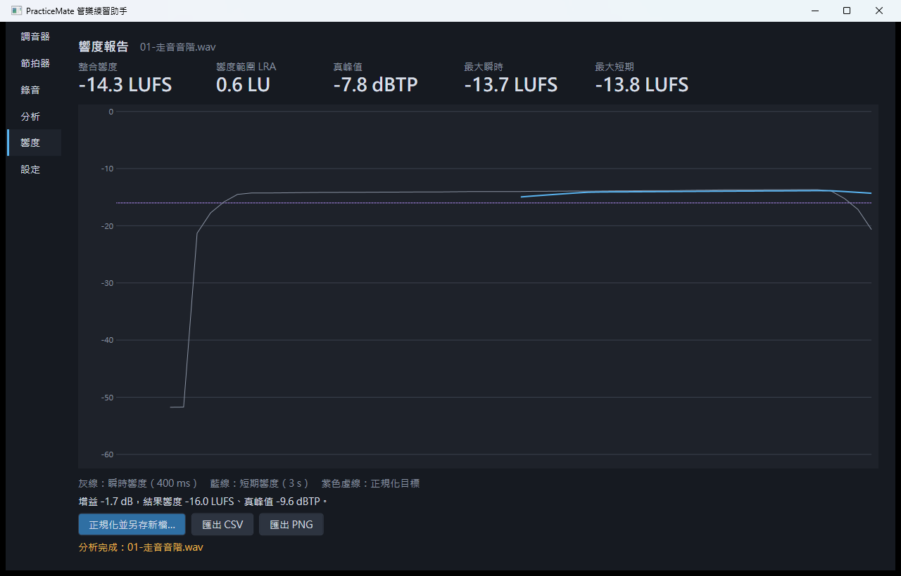
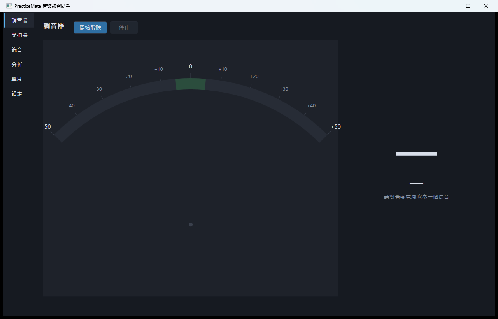
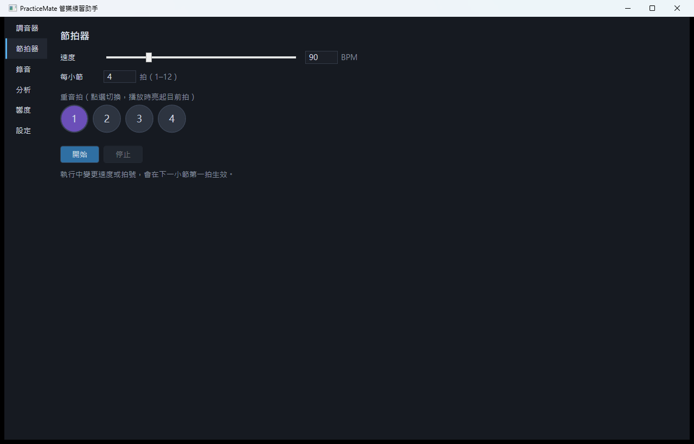
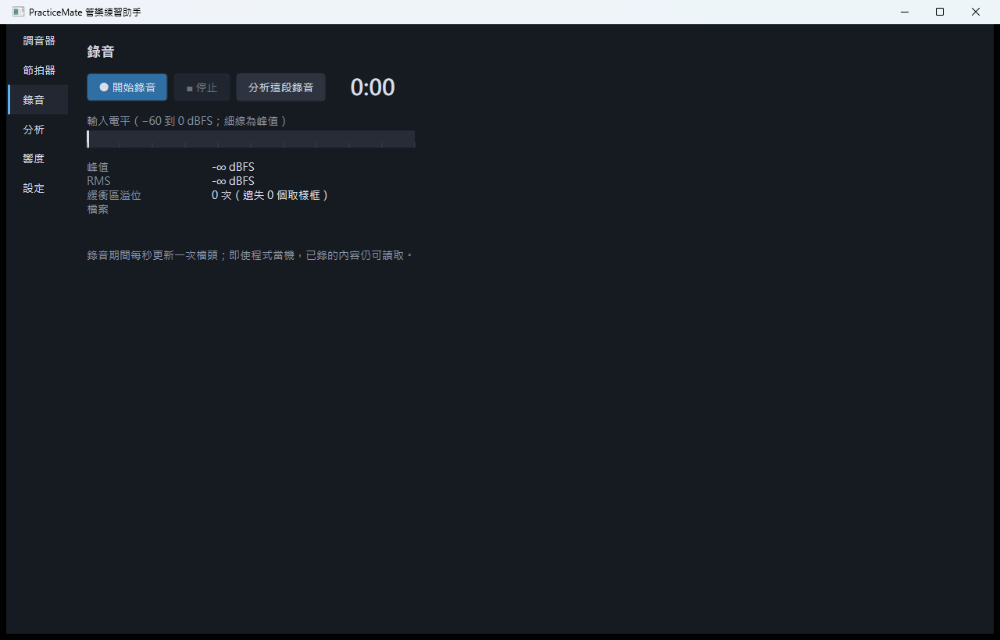
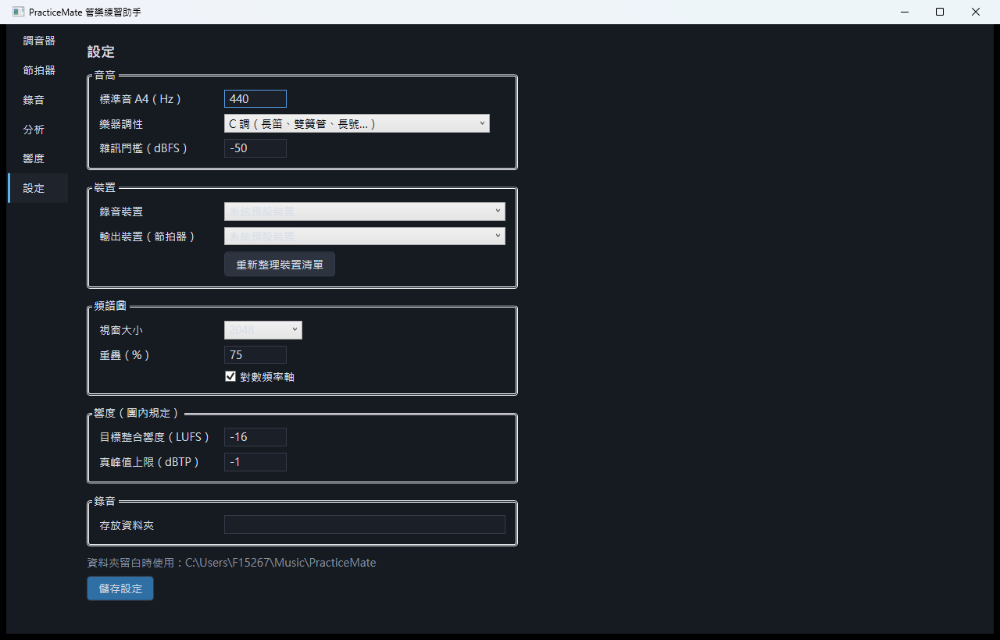
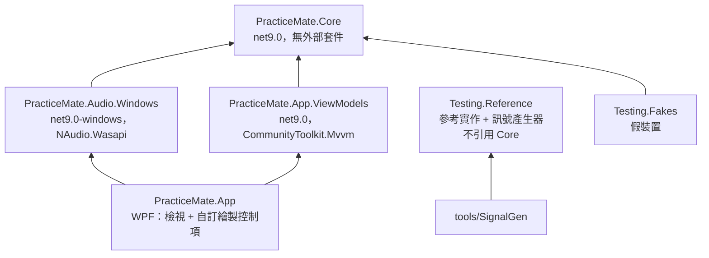
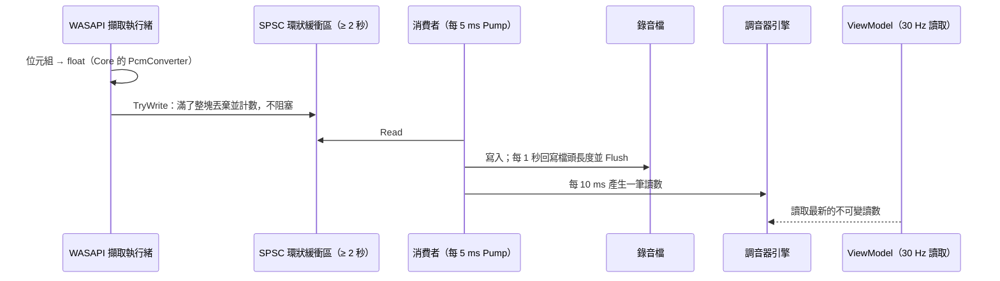

# PracticeMate 管樂練習助手

[](https://github.com/hn83320589/PracticeMate/actions/workflows/ci.yml)

給社區管樂團團員在家練習用的桌面工具：麥克風調音器、節拍器、錄音，錄完自動分析**每個音偏高或偏低多少音分**、**每一拍搶拍或拖拍多少毫秒**、**速度是否漸快或漸慢**，並在繳交前檢查**響度（LUFS）與真峰值（dBTP）**，必要時正規化成團內規定的響度。

- C# / .NET 9 / WPF / MVVM（CommunityToolkit.Mvvm）
- 所有訊號處理（FFT、濾波、取樣率轉換、音高、起音、響度、真峰值）皆自行實作，不使用任何 DSP 套件
- 單機、離線，不呼叫任何網路服務

---

## 目錄

1. [功能與操作](#功能與操作)
2. [建置與執行](#建置與執行)
3. [架構](#架構)
4. [演算法](#演算法)
5. [測試](#測試)
6. [效能](#效能)
7. [設計取捨](#設計取捨)
8. [已知限制](#已知限制)

---

## 功能與操作

### 分析：波形、頻譜圖、音準報告



開啟 WAV（或從錄音頁按「分析這段錄音」）後在背景分析，可隨時取消。波形與頻譜圖**共用同一條時間軸**：滾輪以游標為中心縮放、拖曳平移、雙擊顯示全部。音準報告以長條圖列出每個音符的音分偏差（綠 ≤ 5、黃 ≤ 15、紅 > 15 音分）。

### 節拍報告



輸入速度（BPM）與第一拍時刻後即時重算（不需重新分析）：每拍的提前／延後毫秒數、平均、標準差，以及「速度穩定／漸快／漸慢」。上圖為範例檔 `samples/02-搶拍與拖拍.wav`，報告值與預期結果檔逐拍一致。

### 響度報告與正規化



整合響度、LRA、真峰值、最大瞬時／短期響度與響度曲線；可依設定的目標響度與真峰值上限輸出正規化後的新檔（受峰值限制時會說明改以峰值為準）。

### 調音器、節拍器、錄音、設定

| 調音器 | 節拍器 |
|---|---|
|  |  |
| **錄音** | **設定** |
|  |  |

- **調音器**：音名、八度、音分與指針，每秒更新 30 次（引擎每秒計算 100 次）；可設定 A4（415–466 Hz）與移調樂器（C、B♭、E♭、F），顯示記譜音高並附實際音高；音量太小或沒有明確音高時顯示「—」。
- **節拍器**：30–300 BPM、每小節 1–12 拍、可點選任一拍為重音；執行中變更於下一小節生效。
- **錄音**：32 位元浮點 WAV，預設存於 `%UserProfile%\Music\PracticeMate\`，檔名 `yyyyMMdd-HHmmss.wav`；顯示輸入電平與緩衝區溢位次數；裝置拔除或預設裝置變更時自動停止並保留已錄部分。
- **設定**：存於 `%LocalAppData%\PracticeMate\settings.json`；錄音／輸出裝置、頻譜圖視窗與重疊、線性／對數頻率軸、響度目標與真峰值上限。
- 報告可匯出 **CSV（UTF-8 with BOM）** 與 **PNG**。

---

## 建置與執行

需求：Windows 10/11、.NET SDK 9.0.x。

```powershell
dotnet build PracticeMate.sln -c Release
dotnet test  PracticeMate.sln -c Release                              # 全部測試（含效能測試）
dotnet test  PracticeMate.sln -c Release --filter "Category!=Performance"  # CI 使用的命令
dotnet run   --project src/PracticeMate.App -c Release                # 啟動程式
dotnet run   --project src/PracticeMate.App -c Release -- samples\01-走音音階.wav   # 啟動並直接分析檔案
```

發佈單一執行檔（與 CI 相同）：

```powershell
dotnet publish src/PracticeMate.App -c Release -r win-x64 --self-contained true -p:PublishSingleFile=true -o publish/win-x64
```

CI（GitHub Actions，`windows-latest`，setup-dotnet 9.0.x）每次 push 建置、測試並上傳 `PracticeMate-win-x64` 發佈檔與測試結果為 artifact。效能測試在 CI 上只供參考，不影響綠燈（runner 硬體不固定）。

### 測試訊號產生器與範例錄音

```powershell
dotnet run --project tools/PracticeMate.SignalGen -c Release -- samples
```

產生 `samples/` 下的範例錄音，每份附「預期結果」說明檔：

| 檔案 | 內容 | 預期結果 |
|---|---|---|
| `01-走音音階.wav` | C4–C5 連音音階，每音刻意偏 −30～+30 音分、輕微顫音 | 8 個音、各音偏差 ±2 音分內 |
| `02-搶拍與拖拍.wav` | 100 BPM、16 拍，逐拍刻意偏 −50～+45 ms | 逐拍偏差 ±5 ms 內、速度穩定 |
| `03-漸快.wav` | 120 → 122.4 BPM（+2%） | 判定為「漸快」 |
| `04-響度偏小.wav`、`05-響度偏大.wav` | 同一樂句兩種音量 | −33.0 與 −10.1 LUFS，正規化後皆為 −16.0 LUFS |

測試 `SampleRecordingsTests` 會以正式分析流程檢查這些檔案確實符合預期結果。

---

## 架構



| 專案 | 內容 |
|---|---|
| **Core** | WAV 讀寫、FFT、視窗、雙二階濾波、取樣率轉換、音高、音名、調音器引擎、音符切分、起音、節拍報告、響度、LRA、真峰值、正規化、節拍器排程與點擊聲、SPSC 環狀緩衝區、最小最大抽樣、CSV 報告、擷取工作階段 |
| **Audio.Windows** | 只有 WASAPI 擷取／輸出與裝置列舉／通知，實作 Core 的 `IAudioCaptureDevice`、`IAudioRenderDevice`、`IAudioDeviceCatalog` |
| **App.ViewModels** | 各頁 ViewModel 與服務介面（對話框、PNG 匯出、UI 執行緒、設定檔） |
| **App** | XAML 檢視、自訂繪製控制項（指針、電平表、波形、頻譜圖、長條圖、響度曲線）、組合根 |

依賴規則由 `Architecture.Tests` 以 `System.Reflection.Metadata` 自動檢查：Core 與 ViewModels 不引用 UI／Windows 組件；參考實作不引用任何正式程式碼；Audio.Windows 只能使用白名單內的 NAudio 型別（裝置列舉、`WasapiCapture`、`WasapiOut`、格式描述），不得使用 NAudio 的 DSP、重新取樣或檔案解碼；任何組件都不得引用 MathNet／FftSharp／NWaves。

### 即時資料流



- **時間**：所有時間計算都以取樣索引（整數）表示，只在顯示與 CSV 時換算成秒；「現在時間」一律透過 `TimeProvider`（錄音檔名、計時器、測試用 `FakeTimeProvider`）。
- **錄音當機安全**：檔頭一開始寫入長度 0；每累積 1 秒（以取樣數計，不依賴時鐘）回寫長度並 `Flush(true)`。當機時遺失的資料不超過最後一次更新之後的部分；讀取器遇到長度為 0 或超過檔案的檔頭會改依實際長度讀取並提示。
- **裝置拔除**：Audio.Windows 收到端點通知（或 `AUDCLNT_E_DEVICE_INVALIDATED`）就停止串流並回報原因；消費者排空緩衝、寫最終檔頭後結束，畫面顯示中文原因與已保存長度。預設裝置變更只在「跟隨系統預設」時才停止。
- **分析**：只有全部階段完成才回傳結果；取消時拋出 `OperationCanceledException`，畫面保留上一次的完整結果。進度依各階段成本加權並保證單調遞增。

---

## 演算法

### FFT

- **2 的冪次**：迭代式基數 2（bit-reversal + butterfly）。
- **其他長度**（含質數）：Bluestein（chirp-z），以長度 ≥ 2N−1 的 2 的冪次 FFT 做卷積。chirp 角度以 `n² mod 2N` 先降冪再計算，避免大角度的 sin/cos 精度損失。
- 旋轉因子逐一以 `Math.SinCos` 直接計算（不遞推，避免累積誤差）。
- **實數 FFT**：偶數長度把實數序列打包成 N/2 點複數序列做一次 FFT 再分離；奇數長度走複數 FFT。
- 計畫不可變且依長度快取，暫存區向 `ArrayPool` 租用，可多執行緒共用。
- 驗證：N = 1–10,000（含 8191、9973 等質數）與 O(N²) 直接 DFT 的相對誤差 ≤ 1e-9·log₂N；正反往返 ≤ 1e-12。

### 音高偵測：McLeod（NSDF）選週期 + 泛音 DTFT 精修

1. **NSDF**（McLeod Pitch Method）：n(τ) = 2r(τ)/m(τ)，r 以零填充的實數 FFT 計算自相關，m(τ) = Σ(x[j]² + x[j+τ]²) 遞推。
2. **選週期**：各正值區段取最大值，選第一個 ≥ 0.9 × 全域最大者——以週期性判斷，能處理**缺少基頻**的音色並抑制八度錯誤；NSDF 峰值即 clarity（0–1），用於有聲／無聲判定與調音器雜訊門檻。
3. **精修頻率**：技術驗證發現 MPM 在無雜訊時幾乎無偏差，但 20 dB 白雜訊下低音純音誤差達 2–3 音分（白雜訊的 雜訊×雜訊 自相關在相鄰延遲間快速變動，把寬峰拉偏約 1 個取樣）。因此改由 `HarmonicFrequencyRefiner`：在最強的數個泛音附近，以 Newton 法求 Hann 視窗 **DTFT 功率的極大值**（單一弦波於白雜訊中的最大概似估計），再以功率加權最小平方合併 f₀ = Σ P_h·h·f_h / Σ P_h·h²（缺少基頻時 P₁ ≈ 0，自然不影響）。
4. 分析視窗約 80 ms（48 kHz → 4096 點），每 10 ms 一點；調音器為降低延遲用約 40 ms（2048 點）。

結果（44.1/48/96 kHz、55–1760 Hz、純音／鋸齒波／方波／缺基頻、SNR 20 dB）：穩定段逐幀誤差中位數最差 0.39 音分、95% 幀最差 0.97 音分、八度錯誤 0%。

**音名**：m = 69 + 12·log₂(f/A4)，音名 = floor(m + 0.5)（剛好 ±50 音分取較高），音分 = 100·(m − 音名)；m 先四捨五入到 1e-9 半音，避免浮點誤差讓「剛好 +50」落到 49.9999。升記號、C4 = MIDI 60；記譜音高 = 實際 + 移調半音（B♭ +2、E♭ +9、F +7）。

**調音器**：每 10 ms 偵測一次；雜訊門檻 −50 dBFS + clarity 遲滯（進入 0.85、維持 0.75），連續 3 次無音才顯示「—」；最近 3 點取中位數去跳動，音高跳超過 1 半音時清空歷史。實測從音高改變到顯示改變 ≤ 100 ms。

### 音符切分

完全依規格：相同 round(m) 的連續有聲點成段；夾在同音名之間、短於 30 ms 的無聲或音名跳動併入；≥ 100 ms 才成為音符；音準 = 中間 60% 時間內各點音分的中位數。

### 起音偵測：SuperFlux + 包絡回溯

1. STFT：約 21 ms Hann 視窗、hop 5 ms；對數壓縮 L = log(1 + 1000·|X|)。
2. **SuperFlux**：與 10 ms 前的訊框比較前，先沿頻率做 3 bin 最大值濾波，顫音造成的頻率小幅移動不會被當成新起音。通量 = Σ max(0, L_n − maxfilt(L_{n−2}))。
3. 自適應門檻：±30 ms 局部最大，且高於 [−100, +70] ms 區域平均 + 0.06 × 全段最大；間隔至少 50 ms。
4. **時間精修**：通量峰值落在起音中段（30 ms 起音會偏晚 10–15 ms），因此在 1 ms 解析度、10 ms 視窗的 RMS 包絡上，從峰值往回找「首次超過 底噪 + 10%×(峰值 − 底噪)」的位置。

結果：打擊、撥弦（指數衰減）、管樂（30 ms 起音）三類訊號，F 值 ≥ 0.95、起音誤差 ≤ 10 ms（實測多數 < 5 ms）。

### 節拍報告與漸快判定

拍點 b_j = 起點 + round(j·60·fs/BPM)；起音對應最近拍點，偏差 = 起音 − 拍點（正 = 拖拍）；相距超過 1/4 拍為「拍點外」。
**漸快／漸慢**：偏差（ms）對拍序做最小平方線性迴歸，斜率的 t 統計量 t = b / SE(b)（df = n − 2），以 Student t 分布求雙尾 p 值（正規化不完全 Beta 函數，連分式＋Lanczos ln Γ，自行實作）。p < 0.05 且 |斜率| > 0.5 ms/拍時判定；斜率 < 0（越來越早到）為漸快。少於 8 拍顯示「資料不足」。

### 響度（ITU-R BS.1770-4、EBU Tech 3341/3342）

- **K 加權**：48 kHz 直接用標準表列係數。其他取樣率由類比原型以**預扭曲雙線性轉換**重新設計（K = tan(π·f₀/fs)）：
  - 高架：H(s') = (V_h·s'² + (V_b/Q)·s' + 1)/(s'² + s'/Q + 1)，f₀ = 1681.974450955533 Hz、V_h = 10^(3.999843853973347/20)、Q = 0.7071752369554196；V_b = V_h^0.4996667741545416（此指數取自 B. De Man 對標準係數的反推，與 libebur128 相同）。
  - 高通：f₀ = 38.13547087602444 Hz、Q = 0.5003270373238773，分子沿用標準表的 [1, −2, 1]。
  - 驗證：48 kHz 的設計結果與標準係數相差 < 1e-6；44.1/96 kHz 與 48 kHz 的響應在 30 Hz–10 kHz 相差 < 0.03 dB。
- 每聲道 K 加權後平方，累加成 100 ms 子區塊（邊界 round(i·fs/10)）；瞬時 = 4 子區塊（400 ms）、短期 = 30 子區塊（3 s），每 100 ms 一點，時間戳為**視窗結束**時刻。
- **整合響度**：400 ms 區塊、75% 重疊，絕對閘 −70 LUFS、相對閘 −10 LU；L、R 權重 1.0；單聲道只計一次。全被閘掉 → −∞（畫面顯示「—」）。
- **LRA**：短期響度，絕對閘 −70 LUFS、相對閘 −20 LU，LRA = P95 − P10（排序後線性內插百分位）。

### 真峰值

- fs < 176.4 kHz：**4 倍多相 FIR 過取樣**。原型為 Kaiser 視窗 sinc（每相 32 taps、阻帶 70 dB、`Vector<float>` SIMD），截止在原取樣率的 Nyquist——第 0 相恰為單位脈衝，原取樣點不變，真峰值永遠 ≥ 取樣峰值。
- 4 倍過取樣對接近 Nyquist 的正弦最多會低估約 0.7 dB，因此對接近目前最大值（−0.9 dB 內）的過取樣局部極值再做三點**拋物線內插**精修。
- fs ≥ 176.4 kHz：直接取樣峰值。
- 定義：全零 → −∞ dBTP；單一取樣脈衝 a → 20·log₁₀|a| dBTP。
- 驗證：fs/4 加 45° 相位（每個取樣只有 −3 dB）與 20 Hz–0.4·fs 的隨機正弦，誤差 ≤ 0.3 dB。

### 正規化

增益 = 目標 − 整合響度；若套用後真峰值超過上限，改以「上限 − 真峰值」為增益並說明。只乘固定增益（不壓縮、不限幅），因此響度與真峰值精確平移同樣 dB；輸出 32 位元浮點 WAV，先寫暫存檔、完成後才更名。

### 取樣率轉換

分析時取樣率不是 44.1／48／96 kHz 會先轉成 48 kHz（真峰值仍以原始取樣率計算）。方法：有理數 L/M（以最大公因數約分，如 44.1→48 = 160/147、192→48 = 1/4）的**多相 windowed-sinc**，Kaiser 視窗、通帶至 0.43·min(fin, fout)、阻帶自 0.5·min(fin, fout) 起衰減 90 dB；中心對稱（零相位）設計，輸出第 m 點精確對應輸入時間 m·M/L，不引入延遲。

### 其他

- **頻譜圖**：視窗 64–16384、重疊 0–95% 可設定，訊框以 f·hop 為中心；以 8 位元 dB（0.5 dB 步進）儲存；顯示支援線性與對數頻率軸（f = f_min·(f_max/f_min)^(y/H)），bin 之間線性內插。
- **最小最大抽樣**：第 c 欄涵蓋 [s + ⌊c·L/W⌋, s + ⌊(c+1)·L/W⌋)（整數運算），放大到一欄不足一個取樣時取單一取樣；以每層 ×64 的分層金字塔加速，結果與暴力計算完全相同。
- **節拍器**：第 k 拍起點 = 區段起點 + round(k·60·fs/BPM)，以 k 直接整數計算、不累積；速度變更時，下一小節第一拍以舊速度算出起點，之後以新速度從 k = 0 重新起算。點擊聲：1000 Hz（重音 1500 Hz）、20 ms、頭尾 2 ms 升餘弦、−6 dBFS。
- **環狀緩衝區**：SPSC、64 位元單調索引搭配 `Volatile` 讀寫（acquire/release），讀寫索引分屬不同 cache line；寫入整塊或全不，滿了丟棄新資料並計數。

---

## 測試

```text
PracticeMate.Core.Tests             395
PracticeMate.App.ViewModels.Tests    65
PracticeMate.Architecture.Tests      10
PracticeMate.Performance.Tests        2
PracticeMate.App.Tests                2   （WPF 實際繪製：PNG 匯出）
```

- 框架 xUnit；所有測試在本機與 CI 全數通過。
- **性質測試**（17 組，固定基礎種子；失敗時訊息印出種子，設定環境變數 `PM_PROP_SEED=<種子>` 即可只重跑該案例）：FFT vs DFT、FFT 往返、實數 vs 複數 FFT、實數 FFT 往返、環狀緩衝區跨執行緒無遺失、環狀緩衝區溢位計數、最小最大抽樣欄位、最小最大區間查詢、音高、起音、響度 vs 參考實作、真峰值、取樣率轉換、WAV 寫入讀取往返、節拍器公式、分析任意時間點取消、時間軸縮放平移。

### 參考實作（與正式程式碼互相獨立）

`tests/PracticeMate.Testing.Reference` **不引用任何正式程式碼**（由架構測試強制）。

| 參考實作 | 用途 |
|---|---|
| `ReferenceDft` | O(N²) 直接 DFT，角度以 (k·n) mod N 降冪後計算 |
| `ReferenceLoudness` | 逐取樣直接差分方程做 K 加權，每個 400 ms 區塊直接加總平方後閘控（不使用子區塊累加） |
| `SignalGenerator`、`PerformanceSynth` | 已知音高、起音時刻、響度與峰值的合成音訊：純音／鋸齒／方波／缺基頻、顫音、連音滑音、30 ms 起音的管樂、撥弦、打擊、刻意走音、刻意搶拍拖拍、漸快 |
| `RefWavBuilder` | 手刻各種 WAV 位元組（含 24 位元負數、8 位元、EXTENSIBLE、奇數長度區塊、刻意損毀的檔頭） |

假裝置（`FakeCaptureDevice`、`FakeRenderDevice`）放在另一個專案 `Testing.Fakes`，因為它們必須實作 Core 的介面。

---

## 效能

測量環境：Intel Core i7-13700（24 邏輯處理器）、32 GB RAM、Windows 11 Pro、.NET 9.0（Release）。

| 項目 | 結果 | 驗收 |
|---|---|---|
| 10 分鐘 48 kHz 立體聲完整分析 | **4.1–5.3 s** | ≤ 10 s |
| 　音高軌跡 | 2.7 s | |
| 　響度 + LRA | 0.5 s | |
| 　起音偵測 | 0.5 s | |
| 　頻譜圖（2048 點、75% 重疊） | 0.3 s | |
| 　真峰值（4 倍過取樣） | 0.15 s | |
| 調音器處理一個 10 ms 區塊 | 中位數 0.31 ms（p99 0.53–0.75 ms，偶發最大約 1 ms） | ≤ 1 ms |

數值為單獨執行效能測試、重複 3 次的範圍；詳見 [測試報告](docs/test-report.md)。各階段內部以 `Parallel.For` 分段平行。調音器在背景消費者執行緒處理（不在擷取回呼內），偶發超過 1 ms 的區塊只會短暫延後顯示，不會遺失音訊（環狀緩衝區可容納 2 秒）。音高軌跡最耗時（每幀約 0.7 ms，主要在泛音 DTFT 精修）；處理器核心少的電腦分析時間會明顯增加（約與核心數成反比）。

---

## 設計取捨

- **音高：MPM 選週期 + DTFT 精修**，而不是單純 YIN／MPM。單純自相關法在 20 dB 雜訊下對低音純音有數音分誤差；精修使運算量增加約一倍，換來 < 1 音分的精度。
- **分析視窗 80 ms、調音器 40 ms**：分析重精度（55 Hz 也能 < 1 音分），調音器重延遲（≤ 100 ms）。
- **節拍器 BPM 為整數**：讓 round(k·60·fs/BPM) 能全以整數運算、絕不漂移；節拍報告的 BPM 則允許小數。
- **環狀緩衝區溢位整塊丟棄**：保持交錯聲道對齊，且「丟棄新資料、不覆寫舊資料」符合規格。
- **預設裝置變更只在「跟隨系統預設」時停止**：使用者明確選了 USB 麥克風時，插耳機不應中斷錄音。
- **響度在分析取樣率計算、真峰值在原始取樣率計算**：遵守「非 44.1/48/96 kHz 先轉 48 kHz」的規則，同時避免取樣率轉換改變樣本間峰值。
- **擷取的消費者邏輯是同步的 `Pump()`**：正式環境由背景迴圈定期呼叫，測試直接呼叫，所有錄音、當機、拔除、溢位情境都能確定地測試。
- **檔頭以取樣數（每 1 秒音訊）更新**，而非牆上時鐘：行為可確定、可測試。
- **自寫性質測試小工具**而非 FsCheck：需求只有固定種子與可重現的失敗訊息，少一個依賴。
- **頻譜圖以 8 位元 dB 儲存**：10 分鐘 48 kHz（2048 點、75% 重疊）約 58 MB。

## 已知限制

- **音準中位數與顫音**：音準依規格取中間 60% 的中位數；有顫音而這段時間不是整數個顫音週期時，中位數會偏離中心約 0.3 × 顫音深度（±5 音分顫音約 1.1 音分；無顫音時為 0）。
- **調音器極低音**：調音器使用 40 ms 視窗，55 Hz 附近的純音在 20 dB 雜訊下顯示誤差約 3 音分（錄音分析不受影響）。
- **起音與連音**：沒有音量起伏的連音換音只會由頻譜變化偵測，時間精修無法套用，誤差較大；節拍報告請以吐音（每音都有起音）演奏。包絡以 10 ms RMS 計算，低於 100 Hz 的音在精修時會有少許起伏。
- **節拍對照採「最近拍點」**（依規格）：累積偏差超過 1/4 拍後會對到錯誤的拍點，非常明顯的漸快／漸慢只有前段會被正確對照。
- **節拍器與錄音時鐘不同步**：節拍器在輸出裝置時鐘上執行，錄音在擷取裝置時鐘上；節拍報告的起點由使用者指定。
- **記憶體**：分析時整段音訊載入記憶體（60 分鐘 48 kHz 立體聲約 1.4 GB，加上單聲道混音與頻譜圖）。不支援 RF64（> 4 GB 的 WAV）。
- **K 加權在低取樣率**：8 kHz 等低取樣率因雙線性頻率扭曲，與 48 kHz 響應差約 0.2 dB；但分析前會先轉成 48 kHz，不影響結果。
- **WASAPI**：只支援共用模式；裝置格式需為 PCM 8/16/24/32 或浮點 32/64（實務上共用模式皆為 32 位元浮點）。裝置格式的「有效位元數」未由 NAudio 公開，以容器位元數處理。
- **WAV**：只支援單聲道與立體聲；不支援 A-law、μ-law、ADPCM 等壓縮格式（會以中文說明原因）。

---

設計文件：[docs/design/architecture.md](docs/design/architecture.md)　｜　測試報告：[docs/test-report.md](docs/test-report.md)
