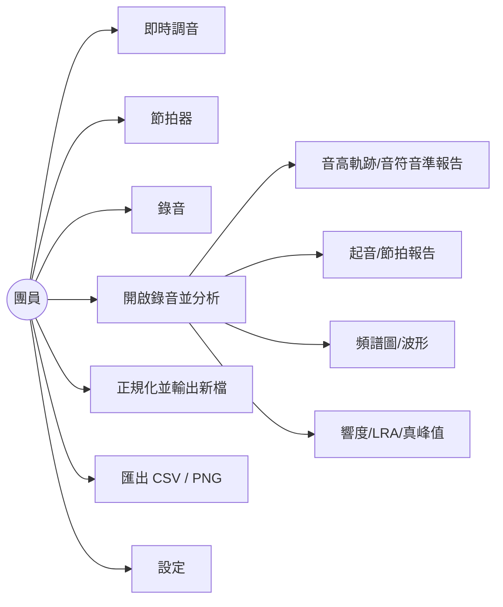
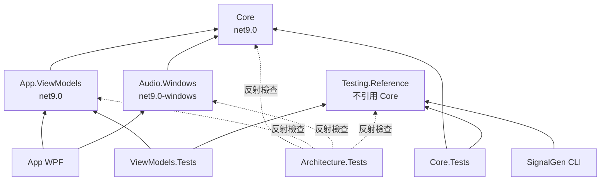
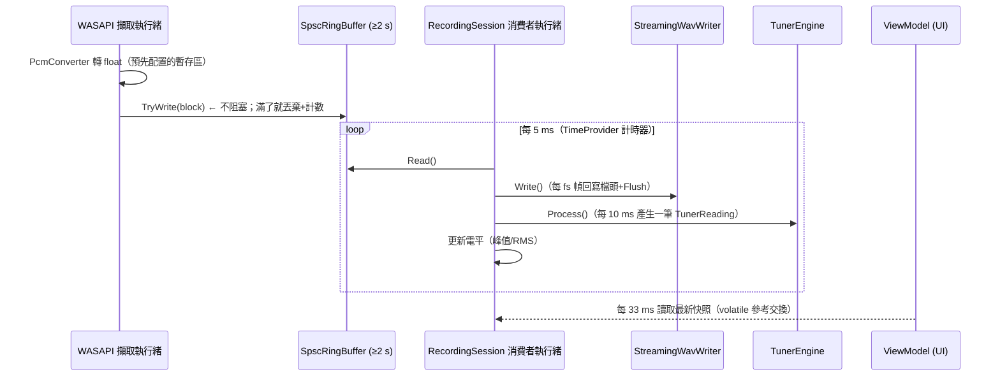
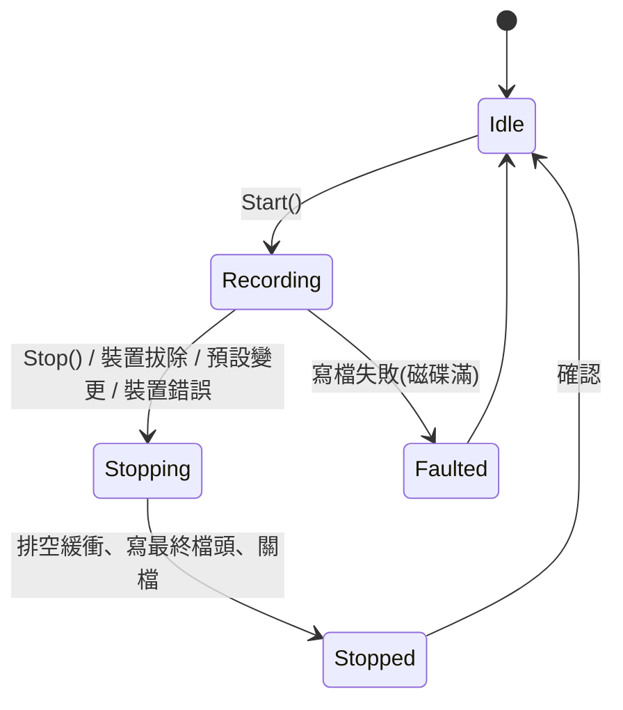
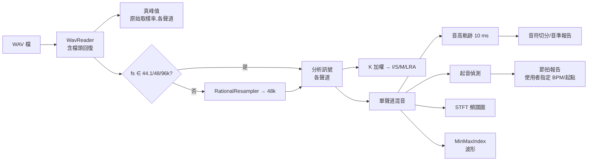

# PracticeMate 系統分析與架構設計（草案 v0.1）

> 狀態：**已確認（v1.0）**，2026-11-06 客戶同意所有建議：
> Q1 採「中位數 ≤ 1 音分、95% 幀 ≤ 3 音分」解讀；§10 套件清單核准；效能測試於 CI 僅供參考不擋綠燈；
> Q3–Q9 依建議解讀。Repo：https://github.com/hn83320589/PracticeMate
> 下文標記 ❓ 的項目皆已依建議定案。

---

## 1. 需求分析

### 1.1 使用者與情境

| 角色 | 情境 | 主要功能 |
|---|---|---|
| 團員（主要使用者） | 在家練習 | 調音器、節拍器、錄音 |
| 團員 | 繳交錄音前 | 分析音準／節拍、檢查響度、正規化輸出 |
| 指揮 | 制定規定 | 規定響度目標與真峰值上限（由團員在設定中輸入） |

單機、單一使用者、單一執行個體、無網路。

### 1.2 功能分解（Use Case）



### 1.3 非功能需求（量化）

| 項目 | 目標 | 對應驗收 |
|---|---|---|
| 調音器更新率 | ≥ 20 Hz（設計值 100 Hz 計算、UI 30 Hz 刷新） | #8 |
| 調音器延遲 | ≤ 100 ms（設計預算約 60 ms） | #8 |
| 調音器單區塊運算 | 10 ms 區塊 ≤ 1 ms | #21 |
| 完整分析效能 | 10 分鐘 48 kHz 立體聲 ≤ 10 s | #21 |
| 擷取回呼 | 永不阻塞、無配置、無鎖 | #5 #19 |
| 錄音當機安全 | 遺失 ≤ 最後一次檔頭更新後（≤ 1 秒音訊） | #3 |
| 最長分析檔 | 60 分鐘 | — |

### 1.4 規格模糊點與我的解讀

| # | 模糊點 | 建議解讀 |
|---|---|---|
| Q1 ❓ | 驗收 #6「穩定段的音高誤差 ≤ 1 音分」是逐幀還是統計值？ | **建議：穩定段（去掉頭尾各 50 ms）逐幀誤差的中位數 ≤ 1 音分，且 95% 的幀 ≤ 3 音分**；八度錯誤（誤差 > 600 音分附近）逐幀計算 < 1%。逐幀全部 ≤ 1 音分在 20 dB SNR、55 Hz、42 ms 視窗下物理上很勉強（見 §9 風險 R1） |
| Q2 | 驗收 #11 的 F 值匹配容許窗 | 採 MIREX 慣例：±50 ms 內視為命中算 F 值；命中者另驗證誤差 ≤ 10 ms |
| Q3 | 節拍器 BPM 是否允許小數 | 節拍器 BPM 為**整數** 30–300，讓 `round(k·60·fs/BPM)` 可全整數運算；節拍報告的 BPM 允許小數（使用者輸入） |
| Q4 | 環狀緩衝區溢位「丟棄新資料」的粒度 | **整個區塊丟棄**（all-or-nothing），保持交錯聲道對齊；計數「溢位次數」與「丟棄的幀數」 |
| Q5 | 「預設裝置變更時停止」 | 只有當前工作階段使用「跟隨系統預設」時才停止；使用者明確指定裝置時，預設變更不影響（否則插耳機就會中斷錄音） |
| Q6 | 響度在原始取樣率還是轉換後計算 | 遵守「分析時非 44.1/48/96 kHz 先轉 48 kHz」：**響度在分析取樣率計算**（400 ms/100 ms 區塊必為整數取樣）；**真峰值在原始取樣率計算**（SRC 會改變樣本間峰值） |
| Q7 | 介於 96 k 與 176.4 k 的取樣率（如 128 k）真峰值 | 一律 4× 過取樣，僅 ≥ 176.4 kHz 不過取樣 |
| Q8 | 節拍對照「最近拍點」對長段漸快會繞回 | 遵守規格（最近拍點），在 README 註明：累積偏差超過 1/4 拍後會對到錯誤拍點；測試訊號設計在範圍內 |
| Q9 | 瞬時／短期響度第一點 | 只在視窗填滿後輸出：瞬時第一點時間戳 400 ms、短期第一點 3 s |

---

## 2. 系統架構

### 2.1 Solution 結構

```
PracticeMate.sln
├─ Directory.Build.props          # net9.0、Nullable、TreatWarningsAsErrors、分析器
├─ Directory.Packages.props       # Central Package Management
├─ .editorconfig
├─ src/
│  ├─ PracticeMate.Core/              net9.0          純邏輯，零外部套件
│  ├─ PracticeMate.Audio.Windows/     net9.0-windows  NAudio.Wasapi（只用裝置/擷取/輸出）
│  ├─ PracticeMate.App.ViewModels/    net9.0          CommunityToolkit.Mvvm
│  └─ PracticeMate.App/               net9.0-windows  WPF 檢視 + 自訂繪製控制項 + 組合根
├─ tools/
│  └─ PracticeMate.SignalGen/         net9.0 Console  產生範例錄音（引用 Testing.Reference）
├─ tests/
│  ├─ PracticeMate.Testing.Reference/ net9.0          參考實作 + 訊號產生器 + 性質測試小工具（不引用 Core）
│  ├─ PracticeMate.Core.Tests/
│  ├─ PracticeMate.App.ViewModels.Tests/
│  ├─ PracticeMate.Architecture.Tests/  依賴規則檢查
│  └─ PracticeMate.Performance.Tests/   效能測試（CI 上獨立 job，不擋綠燈？❓見 §10）
├─ samples/                           SignalGen 產出的範例錄音 + 預期結果.md
├─ docs/design/
└─ .github/workflows/ci.yml
```

### 2.2 專案依賴



**架構測試（Architecture.Tests）以 `System.Reflection.Metadata` 檢查：**
- Core、ViewModels 不引用 `PresentationFramework`、`WindowsBase`、`System.Windows.Forms`、任何 `*.Windows` 組件
- Testing.Reference 不引用 `PracticeMate.Core`（證明參考實作獨立）
- Audio.Windows 引用的 NAudio 型別必須在白名單內（`MMDeviceEnumerator`、`MMDevice`、`IMMNotificationClient`、`WasapiCapture`、`WasapiOut`、`WaveFormat`、`IWaveProvider`…），禁止 `NAudio.Dsp`、`*Resampler*`、`*Reader`、`SampleProviders` 等
- 全 solution 不得出現 MathNet / FftSharp / NWaves 套件

### 2.3 Core 模組切分

```
PracticeMate.Core/
├─ Timing/        SampleClock 換算、整數取樣索引工具（秒只用於顯示）
├─ Dsp/
│  ├─ Fft/        ComplexFft(Radix2 / Bluestein)、RealFft、FftPlanCache
│  ├─ Windows/    Hann / Hamming / BlackmanHarris（periodic / symmetric）
│  ├─ Filters/    Biquad、BiquadDesign（類比原型 + 雙線性 + 預扭曲）
│  ├─ Resampling/ RationalResampler（多相 windowed-sinc）、Oversampler(4×)
│  └─ Stft/       Stft、Spectrogram、FrequencyAxis（線性/對數映射）
├─ IO/Wav/        WavReader、WavFormat、WavReadResult(含警告)、StreamingWavWriter、PcmConverter
├─ Buffers/       SpscRingBuffer、MinMaxIndex（最小最大抽樣 + 金字塔加速）
├─ Music/         NoteMath（MIDI/音名/音分/移調）、Transposition
├─ Pitch/         McLeodPitchDetector、PitchTrackBuilder（每 10 ms）
├─ Tuner/         TunerEngine（滑動視窗、雜訊門檻、平滑）、TunerReading
├─ Analysis/
│  ├─ Notes/      NoteSegmenter、NoteReport
│  ├─ Onsets/     OnsetDetector（SuperFlux + 自適應門檻 + 回溯精修）
│  ├─ Beats/      BeatAligner、BeatReport、TempoTrendTest（線性迴歸 + t 檢定）
│  ├─ Loudness/   KWeighting、LoudnessMeter（I/S/M）、LoudnessRange、TruePeakMeter、Normalizer
│  ├─ Statistics/ StudentT（不完全 Beta 函數）、Percentile
│  └─ AnalysisPipeline.cs   進度、取消、各階段組合
├─ Metronome/     MetronomeScheduler、ClickSynth、MetronomeRenderer
├─ Recording/     RecordingSession（消費者端：環狀緩衝 → 檔案/調音器/電平）
├─ Devices/       IAudioDeviceCatalog、IAudioCaptureDevice、IAudioRenderDevice（介面）
└─ Reports/       CsvWriter（UTF-8 BOM、InvariantCulture、RFC 4180 跳脫）
```

---

## 3. 關鍵介面設計（Core）

```csharp
// --- 裝置（Audio.Windows 實作；測試用 FakeCaptureDevice） ---
public enum AudioDeviceKind { Capture, Render }
public sealed record AudioDeviceInfo(string Id, string Name, AudioDeviceKind Kind, bool IsDefault);
public readonly record struct AudioStreamFormat(int SampleRate, int Channels);

public interface IAudioDeviceCatalog
{
    IReadOnlyList<AudioDeviceInfo> GetDevices(AudioDeviceKind kind);
    event EventHandler<DefaultDeviceChangedEventArgs>? DefaultDeviceChanged;
    event EventHandler<DeviceRemovedEventArgs>? DeviceRemoved;
}

public interface IAudioBlockSink   // 在擷取執行緒呼叫，實作必須不阻塞、不配置
{ void OnCaptured(ReadOnlySpan<float> interleaved); }

public interface IAudioBlockSource // 在輸出執行緒呼叫
{ void Render(Span<float> interleaved); }

public enum StreamStopReason { Requested, DeviceRemoved, DefaultDeviceChanged, DeviceError }

public interface IAudioCaptureDevice : IDisposable
{
    AudioStreamFormat Format { get; }
    void Start(IAudioBlockSink sink);
    void Stop();
    event EventHandler<StreamStoppedEventArgs>? Stopped;   // 含 StopReason 與中文訊息
}
public interface IAudioRenderDevice : IDisposable { /* 對稱：Start(IAudioBlockSource) */ }
```

裝置原生格式（int16/24/32/float）轉 float 由 Core 的 `PcmConverter` 處理（與 WAV 讀取共用），Audio.Windows 不做任何訊號處理。

```csharp
// --- 環狀緩衝區 ---
public sealed class SpscRingBuffer
{
    public SpscRingBuffer(int capacitySamples);       // 進位到 2 的冪次
    public bool TryWrite(ReadOnlySpan<float> block);  // 空間不足 → 整塊丟棄、計數、回傳 false
    public int Read(Span<float> destination);          // 消費者
    public long OverflowCount { get; }                 // 溢位事件數
    public long DroppedSamples { get; }
}
// head/tail 以 Volatile.Read/Write 發布，分開到不同 cache line（避免 false sharing）
```

```csharp
// --- WAV ---
public sealed record WavReadResult(AudioData Audio, WavFormatInfo Format, IReadOnlyList<string> Warnings);
public static class WavReader
{
    public static WavReadResult Read(Stream s);   // 不支援 → WavFormatNotSupportedException(中文原因)
}
public sealed class StreamingWavWriter : IDisposable   // 32-bit float
{
    public StreamingWavWriter(Stream s, int sampleRate, int channels, int headerUpdateIntervalFrames);
    public void Write(ReadOnlySpan<float> interleaved);  // 每累積 N 幀（預設 = fs，即 1 秒）回寫長度欄位並 Flush(true)
    public void Complete();                               // 正常結束：寫最終長度
}
```

```csharp
// --- 分析 ---
public sealed class AnalysisPipeline
{
    public Task<AnalysisResult> RunAsync(AudioData audio, AnalysisOptions options,
        IProgress<AnalysisProgress>? progress, CancellationToken ct);
}
// 節拍報告不在 pipeline 內：使用者調整 BPM/起點後即時重算（只需 onset 列表）
public static BeatReport BeatAligner.Align(IReadOnlyList<long> onsetSamples, int sampleRate,
                                           double bpm, long firstBeatSample);
```

---

## 4. 動態行為

### 4.1 錄音資料流（即時）



- 消費者核心邏輯是同步的 `Pump()` 方法；正式環境由背景執行緒＋`TimeProvider` 計時器呼叫，**測試直接呼叫 `Pump()`**，完全確定性。
- 「模擬慢速消費者」測試：假裝置在另一執行緒高速呼叫 `OnCaptured`，消費者故意不 Pump，量測每次回呼耗時並驗證溢位計數。

### 4.2 錄音狀態機


`Stopped` 帶有原因與中文訊息（例如「錄音裝置已被移除，已保存 3 分 12 秒的錄音」）。

### 4.3 分析流程


- 各階段可平行（`Parallel.For` 以幀區段切分），每段檢查 `CancellationToken`。
- 進度：各階段依預估成本加權；`MonotonicProgress` 包裝確保只回報遞增值。
- 取消：`RunAsync` 只有全部完成才回傳結果；取消時拋 `OperationCanceledException`，ViewModel 保留舊結果或空白，**不會出現半套結果**。正規化輸出先寫 `*.tmp`，完成後 `File.Move`，取消則刪除暫存檔。

---

## 5. 演算法設計

### 5.1 FFT
- 複數 FFT 以 `double`：N 為 2 的冪次 → 迭代式 Radix-2（bit-reversal + butterfly）；其他 N → Bluestein（chirp-z，以 ≥ 2N−1 的 2 的冪次做卷積）；N = 1 直接回傳。
- 旋轉因子以 `Math.SinCos(2π·(k mod N)/N)` **逐一直接計算**（不遞推），保證精度；chirp 用 `k² mod 2N` 避免大角度誤差。
- 實數 FFT：N 偶數 → 打包成 N/2 點複數 FFT + 後處理；N 奇數 → 走複數 FFT。
- `FftPlan` 不可變、可執行緒共用；暫存區由呼叫端提供或 `[ThreadStatic]`。

### 5.2 音高偵測：McLeod Pitch Method（NSDF）
- 選 MPM 而非 YIN 的理由：NSDF 有正規化 clarity 值（0–1），直接作為有聲/無聲判定與調音器雜訊門檻；「第一個超過 k·最大值的峰」規則能有效降低八度錯誤，且對缺少基頻的音色有效（以週期性而非頻譜峰判斷）。
- 參數（48 kHz）：視窗 2048 點（≈ 42.7 ms，可涵蓋 55 Hz 的 2.3 個週期），lag 範圍對應 50–1800 Hz；以 4096 點實數 FFT 計算自相關；k = 0.9；拋物線內插。
- **精修步驟（R1 技術驗證決定）**：拋物線內插在高頻（1760 Hz 週期僅 27 點）可能有數音分偏差。候選精修法：(a) 在峰值附近以 FFT 頻譜的諧波峰做加權最小平方；(b) 在 lag 域以帶限內插求 NSDF 精確極值。先做 spike 量測再定案。
- 分析軌跡：hop = fs/100（44.1k→441、48k→480、96k→960，皆整數）；第 i 點代表以取樣 i·hop 為中心的視窗。
- 有聲判定：clarity ≥ 0.8 且 RMS ≥ −50 dBFS（可設定）。

### 5.3 音名與移調
- `m = 69 + 12·log2(f/A4)`；音名 `n = floor(m + 0.5)`（剛好 +50 取較高音名）；`cents = 100·(m − n)` ∈ [−50, 50)。
- 浮點邊界：先將 m 四捨五入到 1e-9 半音再判定，確保 `f = A4·2^(0.5/12)` 時穩定歸到較高音。
- 記譜音高 = 實際 MIDI + 移調（C 0、B♭ +2、E♭ +9、F +7）；音名升記號；八度 = floor(n/12) − 1（C4 = 60）。

### 5.4 調音器
- 每收到 10 ms 新資料，對最近 2048 點跑 MPM（每秒 100 次）；UI 30 Hz 取最新值。
- 平滑：最近 3 次估計取中位數；遲滯門檻（進入有聲需 clarity ≥ 0.85、離開需 < 0.75，連續 3 次無聲才顯示「—」），避免亂跳。
- 延遲預算：視窗半長 21 ms + 區塊 10 ms + 中位數 20 ms + UI 33 ms ≈ 84 ms（驗收以 Core 引擎輸出時刻量測，不含 UI 刷新）。

### 5.5 音符切分
完全照規格：有聲且 `round(m)` 相同的連續點；短於 30 ms（3 點）的無聲或音名跳動併入同一音符；≥ 100 ms（10 點）才成立；偏差 = 中間 60% 點的音分中位數。

### 5.6 起音偵測
- STFT：1024 點 Hann、hop 5 ms（48k → 240）、對數壓縮幅度 `log(1 + 100|X|)`。
- **SuperFlux**：與前一幀比較前先沿頻率軸做最大值濾波（3 bins），抑制顫音造成的假起音。
- 自適應門檻：`flux[n] > mean(±100 ms) + δ` 且為 ±30 ms 內的局部最大；最小間隔 50 ms。
- **時間精修**：通量峰值落在起音中段（30 ms 起音會偏晚約 10–15 ms），因此在 1 ms 解析度的能量包絡上從峰值往回找「上升起點」（包絡首次超過前段底噪 + 10% 動態的位置）。

### 5.7 節拍報告與漸快判定
- 拍點 `b_j = firstBeat + round(j·60·fs/BPM)`；每個起音找最近拍點，偏差 = 起音 − 拍點（正 = 拖拍）；|偏差| > 1/4 拍列「拍點外」。
- 統計：平均、樣本標準差（n−1）。
- 漸快／漸慢：偏差(ms) 對拍序做最小平方線性迴歸，斜率 t 檢定（df = n−2，雙尾 p < 0.05），且 |斜率| > 0.5 ms/拍 → 斜率 < 0 為「漸快」（越來越早到）、> 0 為「漸慢」；n < 8 顯示「資料不足」。Student t 分布 CDF 以正規化不完全 Beta 函數（連分式）自行實作。

### 5.8 響度（BS.1770-4 / EBU 3341 / 3342）
- K 加權：48 kHz 用標準係數；其他取樣率由類比原型以**預扭曲雙線性轉換**設計：`K = tan(π·f0/fs)`，高架與高通各自代入規格參數（f0、增益、Q）。單元測試驗證此設計在 48 kHz 時與標準係數相差 < 1e-6。
- 閘控：400 ms 區塊、100 ms 步進；絕對閘 −70 LUFS、相對閘 −10 LU；L/R 權重 1.0；單聲道只算一次。
- 瞬時（400 ms）與短期（3 s）每 100 ms 一點，時間戳為視窗結束取樣索引。
- LRA：短期響度 → 絕對閘 −70、相對閘 −20 → 第 95 與第 10 百分位數差（線性內插百分位）。
- 全被閘掉 → `double.NegativeInfinity`，UI 顯示「—」。

### 5.9 真峰值
- ≤ 176.4 kHz 以下：4× 多相 FIR 過取樣（Kaiser 視窗 sinc，每相 32 taps，`Vector<float>` SIMD）；≥ 176.4 kHz 直接取樣值。
- 4× 對接近 Nyquist 的正弦最多低估約 0.7 dB，不符 ≤ 0.3 dB；因此對超過「目前最大值 −0.8 dB」的過取樣局部極值，再以三點拋物線內插精修（只在少數點上執行，成本極低）。
- 定義：TP = max(取樣峰值, 過取樣峰值)；全零 → −∞ dBTP；單一脈衝 a → 20·log10|a| dBTP（設計 phase 0 為 δ，保證不會小於取樣值）。

### 5.10 正規化
- 增益 = 目標 LUFS − 整合響度；若 `TP + 增益 > 上限` → 增益 = 上限 − TP，結果附中文說明（「依真峰值上限調整，實際響度 −17.3 LUFS」）。
- 輸出 32-bit float WAV（原取樣率、原聲道），只乘增益、不做壓縮限幅。

### 5.11 取樣率轉換
有理數比例 L/M（gcd 約分，例 44.1→48 = 160/147、192→48 = 1/4）的多相 windowed-sinc（Kaiser），截止頻率取兩者 Nyquist 較小者的 0.95。

### 5.12 頻譜圖與最小最大抽樣
- STFT 視窗大小（256–16384）、重疊（0–95%）可設定；分析結果以 8-bit dB（−120…0 dBFS）儲存以控制記憶體。
- 對數頻率軸：顯示列 y ↦ `f = fmin·(fmax/fmin)^(y/H)`，於 bin 間線性內插。
- MinMax：第 c 欄涵蓋 `[s + ⌊c·L/W⌋, s + ⌊(c+1)·L/W⌋)`；空區間（放大到 1 欄 < 1 取樣）取單一取樣 `s + ⌊c·L/W⌋`。以分層區塊（每層 ×64）金字塔加速，區間 = 頭尾原始取樣 + 中間金字塔區塊，結果與暴力法**完全相同**。

### 5.13 節拍器
- `start(k) = segStart + (2·k·60·fs + BPM) / (2·BPM)`（整數運算的 round-half-up，k 直接計算，無累積）。
- 速度變更：記為 pending；當排程到達下一小節第一拍時，以該拍（用舊速度算出）的取樣索引為新 `segStart`、k 歸零。
- 點擊聲：1000/1500 Hz、20 ms、頭尾 2 ms 升餘弦、振幅 10^(−6/20)；跨區塊邊界的點擊正確接續。離線渲染測試以區塊串流方式跑 1 小時（不一次配置 1 小時記憶體）。
- 節拍器在輸出裝置時鐘上運行，與擷取裝置時鐘不同步（已知限制；節拍報告使用者自行指定起點）。

---

## 6. ViewModel 設計

| ViewModel | 職責 | 依賴（介面） |
|---|---|---|
| `ShellViewModel` | 頁面導覽、全域錯誤訊息 | — |
| `TunerViewModel` | 音名/八度/音分/指針角度/「—」 | `ITunerFeed`、`TimeProvider` |
| `MetronomeViewModel` | BPM、拍號、重音、啟停、目前拍 | `IMetronomeService` |
| `RecordingViewModel` | 裝置選擇、狀態切換、電平、溢位計數、錄音時間 | `IRecordingService`、`IAudioDeviceCatalog` |
| `AnalysisViewModel` | 開檔、背景分析、進度、取消 | `AnalysisPipeline`、`IFileDialogService` |
| `TimelineViewportViewModel` | 共用 `StartSample`／`SamplesPerPixel`，波形與頻譜圖綁同一實例 → 同步縮放平移 | — |
| `NoteReportViewModel`／`BeatReportViewModel` | 長條圖/偏差圖資料、BPM/起點輸入即時重算 | — |
| `LoudnessViewModel` | I/S/M/LRA/TP 顯示、正規化 | `INormalizer` |
| `SettingsViewModel` | A4、移調、門檻、STFT、響度目標、資料夾 | `ISettingsStore`（JSON 於 %LocalAppData%） |

- UI 執行緒切換：`IUiDispatcher` 介面（App 用 `Dispatcher` 實作，測試用同步實作）。
- 匯出：CSV 由 Core `CsvWriter` 產生（VM 可測）；PNG 透過 `IImageExporter`（App 以 `RenderTargetBitmap` 實作，VM 測試用假實作驗證被呼叫）。
- 組合根：App 的 `App.xaml.cs` 手動組裝（不引入 DI 容器，元件數量不多）。

## 7. WPF 檢視（App）

自訂繪製控制項全部 `FrameworkElement.OnRender` / `DrawingVisual`：
`TunerGauge`、`LevelMeter`、`WaveformView`（綁 MinMax 結果）、`SpectrogramView`（`WriteableBitmap`）、`NoteDeviationChart`、`BeatDeviationChart`、`LoudnessTimeline`。頁面：調音器、節拍器、錄音、分析（波形+頻譜+報告分頁）、響度、設定。

---

## 8. 測試策略

### 8.1 參考實作（`Testing.Reference`，不引用 Core）
- `ReferenceDft`：O(N²) 直接 DFT，角度以 `(k·n) mod N` 降冪後計算。
- `ReferenceLoudness`：逐取樣直接差分方程（48 kHz 標準係數，其他取樣率用獨立撰寫的雙線性設計）＋直接閘控計算。
- `SignalGenerator`：純音、鋸齒、方波、缺基頻（2–6 次泛音）、白雜訊（指定 SNR）、ADSR 包絡（30 ms 起音）、指數衰減撥弦、打擊、顫音、音間滑音、指定起音時刻/走音/漸快的序列；回傳訊號＋真值（ground truth）。
- `RefWavBytes`：手刻各種格式的 WAV 位元組（含 24 位元負數、8 位元、EXTENSIBLE、奇數長度區塊）。
- `Prop.ForAll(seed, iterations, ...)`：自寫的性質測試小工具，失敗時訊息印出 `seed` 與 iteration，可用環境變數 `PM_PROP_SEED` 重現。

### 8.2 性質測試（≥ 8 組）
1. FFT vs DFT（隨機 N ∈ [1, 10000]）
2. FFT 正反往返
3. 實數 FFT vs 複數 FFT
4. 環狀緩衝區多執行緒（隨機區塊大小/速度）
5. 環狀緩衝區溢位計數與不覆寫
6. 最小最大抽樣 vs 暴力法
7. 音高偵測隨機頻率/音色/相位
8. WAV 寫入→讀取往返（隨機格式/長度）
9. 節拍器拍點公式（隨機 BPM/fs/k）
10. 重新取樣：隨機頻率正弦轉換後頻率不變

### 8.3 驗收追溯矩陣

| 驗收 | 測試類別（預估案例數） |
|---|---|
| #1 #2 | `WavReaderTests`、`WavRecoveryTests`（~35） |
| #3 #19 | `RecordingSessionTests`（假裝置、模擬當機、拔除、慢消費者）（~15） |
| #4 | `FftPropertyTests`、`FftTests`（~15） |
| #5 | `SpscRingBufferTests`（~10） |
| #6 #7 #8 | `PitchAccuracyTests`、`NoteMathTests`、`TunerEngineTests`（~45） |
| #9 | `MetronomeSchedulerTests`、`ClickSynthTests`（~15） |
| #10 #11 #12 | `NoteSegmenterTests`、`OnsetDetectorTests`、`BeatAlignerTests`（~30） |
| #13–#16 | `KWeightingTests`、`LoudnessTests`、`LraTests`、`TruePeakTests`、`NormalizerTests`（~40） |
| #17 #18 | `SpectrogramTests`、`MinMaxTests`（~12） |
| #20 | `AnalysisPipelineTests`（~6） |
| #22 | ViewModel 測試（~30） |
| 其他 | Biquad、Resampler、Window、CSV、統計、架構規則（~25） |
| **合計** | **≈ 280**（目標 ≥ 220） |

### 8.4 效能測試
`PracticeMate.Performance.Tests`（`[Trait("Category","Performance")]`）：10 分鐘 48k 立體聲合成訊號完整分析、調音器 10 ms 區塊處理時間（取 1000 次中位數與 p99）。計時用 `TimeProvider.System.GetTimestamp()`。

---

## 9. 技術風險與對策

| # | 風險 | 影響 | 對策 |
|---|---|---|---|
| R1 | 音高 ≤ 1 音分（1760 Hz、20 dB SNR、缺基頻） | 驗收 #6 #10 | **先做技術驗證 spike**（M5 第一步），比較精修方法；同時確認 Q1 的解讀 |
| R2 | 30 ms 起音的起音誤差 ≤ 10 ms | #11 | 包絡回溯精修；spike 驗證三類訊號 |
| R3 | 10 分鐘分析 ≤ 10 s | #21 | 平行化、SIMD、`ArrayPool`；每個里程碑跑效能測試 |
| R4 | 真峰值高頻 ≤ 0.3 dB | #15 | 4× + 局部拋物線精修 |
| R5 | NAudio 裝置事件在 COM 執行緒觸發 | #19 | 事件只設旗標，由消費者執行緒收尾；Audio.Windows 只做轉接 |
| R6 | CI runner 效能不穩 | #21 #25 | 效能測試分開跑；README 數據以本機量測為準 |
| R7 | 60 分鐘檔案記憶體（48k 立體聲 float ≈ 1.4 GB；96k ≈ 2.8 GB） | 大檔 | 以分段陣列（每段 1M 取樣）避免單一巨大 LOH 配置；README 載明記憶體需求；不支援 RF64（> 4 GB WAV） |

---

## 10. 外部套件（需確認）❓

| 套件 | 授權 | 用於 | 備註 |
|---|---|---|---|
| NAudio.Wasapi | MIT | Audio.Windows | 只用裝置列舉、WasapiCapture、WasapiOut |
| CommunityToolkit.Mvvm | MIT | ViewModels | 規格允許 |
| xunit + xunit.runner.visualstudio + Microsoft.NET.Test.Sdk | Apache-2.0 / MIT | Tests | 規格指定 |
| Microsoft.Extensions.TimeProvider.Testing | MIT | Tests | `FakeTimeProvider`，測試計時器與錄音檔名 |

不使用：FsCheck（自寫性質測試小工具，避免多一個依賴）、DI 容器、BenchmarkDotNet。

---

## 11. 開發里程碑（每步可編譯、可測試、獨立 commit）

| 里程碑 | 內容 | 預估工時 |
|---|---|---|
| M0 | Solution 骨架、build props、CI（建置+測試）、架構測試 | 4 h |
| M1 | Testing.Reference：性質測試工具、參考 DFT、訊號產生器 | 8 h |
| M2 | FFT／實數 FFT／視窗／Biquad／重新取樣 | 10 h |
| M3 | WAV 讀取（全格式+回復）、串流寫入器 | 8 h |
| M4 | 環狀緩衝區、RecordingSession（假裝置）、節拍器排程與點擊聲 | 10 h |
| M5 | **音高 spike** → MPM、NoteMath、TunerEngine | 14 h |
| M6 | 音符切分、起音偵測（spike）、節拍報告 | 14 h |
| M7 | K 加權、響度 I/S/M、LRA、真峰值、正規化、參考響度 | 14 h |
| M8 | STFT／頻譜圖、MinMax、AnalysisPipeline（進度/取消）、效能調校 | 10 h |
| M9 | ViewModels + 測試 | 10 h |
| M10 | Audio.Windows（WASAPI 擷取/輸出/裝置事件） | 6 h |
| M11 | WPF 檢視與自訂控制項、CSV/PNG 匯出 | 14 h |
| M12 | SignalGen CLI、範例錄音與預期結果、README、截圖、CI 發佈 artifact | 8 h |
| | **合計** | **≈ 130 h** |

依賴 Core 的 M2–M8 先做（風險最高、驗收最多），UI 最後。
