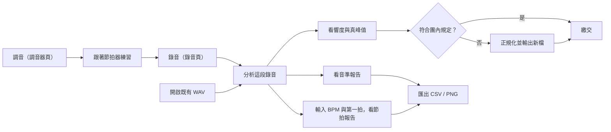
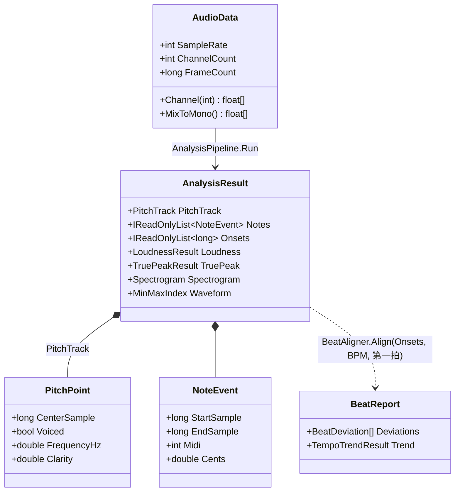
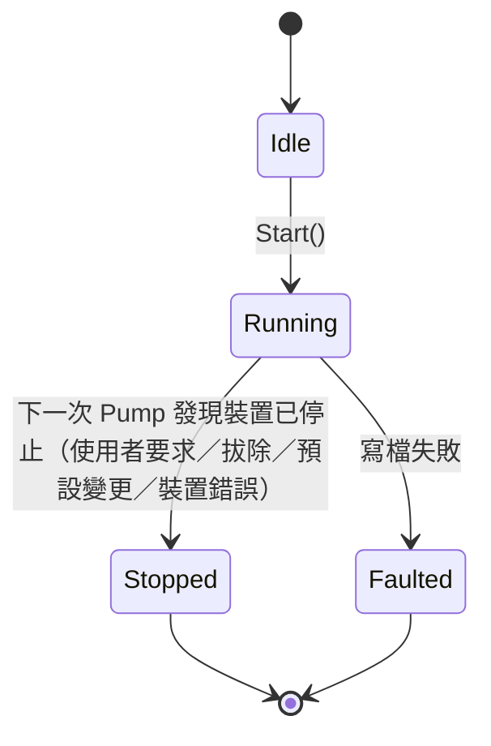

# 02 系統分析

這一章把 01 章的需求拆成系統行為：使用者會走哪些流程、系統裡有哪些核心概念、哪些東西有狀態，以及每項需求落在哪個檔案。

## 主要業務流程

團員的一次完整練習大致如下。重點是「錄音」與「分析」是兩個獨立的流程：分析只吃 WAV 檔，不管檔案是剛錄的還是從別處來的。

## 核心使用情境

### 情境一：錄一段練習

- **前置條件**：有可用的錄音裝置；錄音資料夾可寫入（預設 `%UserProfile%\Music\PracticeMate\`）。
- **主要步驟**：
  1. 在錄音頁選裝置（或「跟隨系統預設」），按「開始錄音」。
  2. 系統以 `yyyyMMdd-HHmmss.wav` 建立檔案，畫面顯示電平、錄音時間、緩衝區溢位次數。
  3. 按「停止」，系統排空緩衝、寫入最終檔頭，顯示「已保存 X 分 Y 秒」。
  4. 按「分析這段錄音」直接跳到分析頁。
- **例外**：
  - 裝置被拔除 → 自動停止，保留已錄部分，顯示中文原因。
  - 系統預設裝置變更 → 只有「跟隨系統預設」時停止。
  - 磁碟寫入失敗 → 進入失敗狀態並顯示原因。
  - 程式當機 → 檔頭每 1 秒更新一次，下次讀取時最多遺失最後 1 秒。

### 情境二：分析並看節拍報告

- **前置條件**：一個 WAV 檔（≤ 60 分鐘）。
- **主要步驟**：
  1. 開啟檔案，背景分析，顯示各階段進度。
  2. 完成後顯示波形、頻譜圖、音準報告。
  3. 輸入 BPM 與第一拍時刻，節拍報告**即時重算**（不重新分析，只用已偵測的起音列表）。
- **例外**：
  - 不支援的格式 → 中文說明原因。
  - 檔頭損壞 → 依實際長度讀取並顯示警告。
  - 中途取消 → 畫面保留上一次的完整結果。

### 情境三：正規化後繳交

- **前置條件**：已完成分析；設定中有目標響度與真峰值上限。
- **主要步驟**：計算增益 = 目標 − 整合響度；套用後若真峰值超過上限，改以「上限 − 真峰值」為增益並說明；輸出 32 位元浮點 WAV（先寫暫存檔，完成才更名）。

## 領域模型

只列關鍵型別。注意幾乎都是不可變的 `record`：分析結果一旦產生就不會被修改，ViewModel 只是把它換掉。

值得注意的設計：`BeatReport` **不在** `AnalysisResult` 裡。節拍報告需要使用者輸入 BPM 與第一拍，而且會反覆調整，所以 `AnalysisResult` 只保存起音列表（`Onsets`），報告由 `BeatAligner.Align()` 隨時重算（`src/PracticeMate.Core/Analysis/Beats/BeatAligner.cs`）。

> 📄 依據：`docs/design/architecture.md` §3「節拍報告不在 pipeline 內：使用者調整 BPM/起點後即時重算」

## 有狀態的實體

### 擷取工作階段（CaptureSession）

`CaptureState` 定義在 `src/PracticeMate.Core/Recording/CaptureSession.cs`。一個工作階段只能啟動一次，結束就丟棄，下次錄音建立新的。

關鍵細節：「停止」不是在呼叫 `RequestStop()` 時發生，而是裝置回報停止後、**下一次 `Pump()`** 排空緩衝並寫完檔頭時才轉為 `Stopped`。這確保停止前送達的每一個取樣都會寫進檔案。

### 錄音頁（RecordingViewModel）

UI 層另有自己的狀態 `RecordingState`（`Idle`、`Recording`、`Stopped`、`Failed`，見 `src/PracticeMate.App.ViewModels/RecordingViewModel.cs`），對應畫面上按鈕的啟用與訊息。它由 Core 的 `CaptureState` 轉換而來，兩者分開是因為 UI 需要「停止後還顯示保存訊息、可按分析」的狀態，而 Core 的工作階段已經結束。

### 調音器的有聲判定（遲滯）

調音器不是每一幀獨立判斷有沒有音，而是帶遲滯（hysteresis）的狀態：進入「有聲」需要 clarity ≥ 0.85，維持只需 ≥ 0.75；連續 3 次無聲才顯示「—」。目的是避免指針在音的邊緣閃爍。實作在 `TunerEngine.Produce()`（`src/PracticeMate.Core/Tuner/TunerEngine.cs`）。

## 需求追溯表

| 需求 | 主要實作 | 主要測試 |
|---|---|---|
| FR-01 FR-02 WAV 讀取與回復 | `src/PracticeMate.Core/IO/Wav/WavReader.cs`、`src/PracticeMate.Core/Audio/PcmConverter.cs` | `tests/PracticeMate.Core.Tests/IO/WavReaderTests.cs`、`tests/PracticeMate.Core.Tests/IO/WavRecoveryTests.cs` |
| FR-03 當機安全錄音 | `src/PracticeMate.Core/IO/Wav/StreamingWavWriter.cs`、`src/PracticeMate.Core/Recording/CaptureSession.cs` | `tests/PracticeMate.Core.Tests/IO/StreamingWavWriterTests.cs`、`tests/PracticeMate.Core.Tests/Recording/CaptureSessionTests.cs` |
| FR-04 調音器 | `src/PracticeMate.Core/Tuner/TunerEngine.cs`、`src/PracticeMate.Core/Music/NoteMath.cs` | `tests/PracticeMate.Core.Tests/Tuner/TunerEngineTests.cs`、`tests/PracticeMate.Core.Tests/Tuner/TunerAccuracyTests.cs` |
| FR-05 節拍器 | `src/PracticeMate.Core/Metronome/MetronomeScheduler.cs`、`src/PracticeMate.Core/Metronome/ClickSynth.cs`、`src/PracticeMate.Core/Metronome/MetronomeRenderer.cs` | `tests/PracticeMate.Core.Tests/Metronome/MetronomeTests.cs` |
| FR-06 音高與音符 | `src/PracticeMate.Core/Pitch/McLeodPitchDetector.cs`、`src/PracticeMate.Core/Pitch/HarmonicFrequencyRefiner.cs`、`src/PracticeMate.Core/Analysis/Notes/NoteSegmenter.cs` | `tests/PracticeMate.Core.Tests/Pitch/PitchAccuracyTests.cs`、`tests/PracticeMate.Core.Tests/Analysis/NoteSegmenterTests.cs` |
| FR-07 FR-08 起音與節拍 | `src/PracticeMate.Core/Analysis/Onsets/OnsetDetector.cs`、`src/PracticeMate.Core/Analysis/Beats/BeatAligner.cs`、`src/PracticeMate.Core/Analysis/Statistics/StudentT.cs` | `tests/PracticeMate.Core.Tests/Analysis/OnsetDetectorTests.cs`、`tests/PracticeMate.Core.Tests/Analysis/BeatAlignerTests.cs` |
| FR-09 FR-10 響度、真峰值、正規化 | `src/PracticeMate.Core/Analysis/Loudness/` | `tests/PracticeMate.Core.Tests/Analysis/LoudnessTests.cs`、`tests/PracticeMate.Core.Tests/Analysis/TruePeakAndNormalizerTests.cs` |
| FR-11 頻譜圖與波形 | `src/PracticeMate.Core/Dsp/Stft/Spectrogram.cs`、`src/PracticeMate.Core/Buffers/MinMaxIndex.cs`、`src/PracticeMate.App.ViewModels/TimelineViewModel.cs` | `tests/PracticeMate.Core.Tests/Dsp/SpectrogramAndMinMaxTests.cs`、`tests/PracticeMate.App.ViewModels.Tests/TimelineViewModelTests.cs` |
| FR-12 裝置拔除 | `src/PracticeMate.Audio.Windows/WasapiAudioSystem.cs`、`src/PracticeMate.Audio.Windows/WasapiCaptureDevice.cs`、`CaptureSession` | `tests/PracticeMate.Core.Tests/Recording/CaptureSessionTests.cs` |
| FR-13 取消與進度 | `src/PracticeMate.Core/Analysis/AnalysisPipeline.cs` | `tests/PracticeMate.Core.Tests/Analysis/AnalysisPipelineTests.cs` |
| FR-14 CSV / PNG 匯出 | `src/PracticeMate.Core/Reports/CsvReport.cs`、`src/PracticeMate.App/Services/WpfServices.cs` | `tests/PracticeMate.Core.Tests/Reports/CsvReportTests.cs`、`tests/PracticeMate.App.Tests/ChartImageExporterTests.cs` |
| FR-15 範例錄音 | `tools/PracticeMate.SignalGen/Program.cs`、`samples/` | `tests/PracticeMate.Core.Tests/Analysis/SampleRecordingsTests.cs` |
| NFR-01 NFR-02 效能 | 同上各模組 | `tests/PracticeMate.Performance.Tests/PerformanceTests.cs` |
| NFR-04 NFR-05 架構規則 | 專案參考關係 | `tests/PracticeMate.Architecture.Tests/` |
