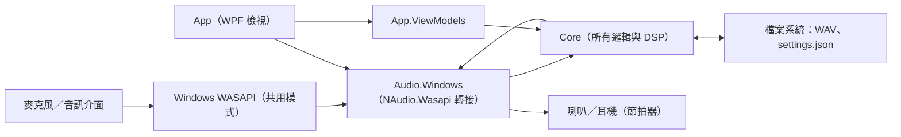
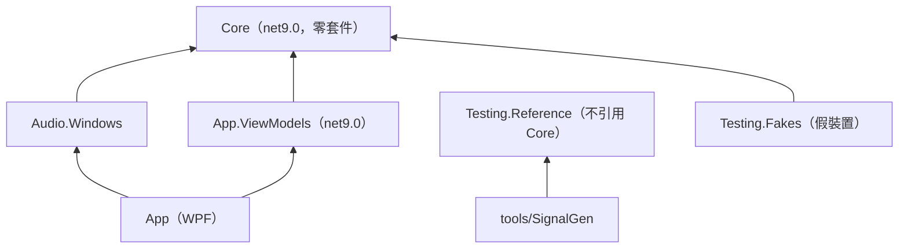
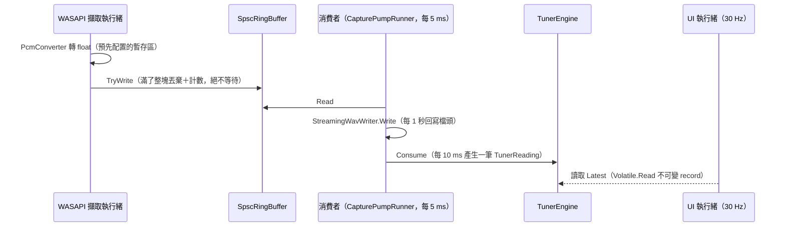

# 03 架構設計

## 整體架構

先看外部邊界：程式唯一碰到的「外部系統」是 Windows 音訊堆疊（WASAPI）與檔案系統。沒有網路、沒有資料庫。



## 分層與專案

> 📄 依據：`docs/design/architecture.md` §2.1、§2.2；README「架構」

| 專案 | 目標框架 | 職責 | 可以相依 |
|---|---|---|---|
| `src/PracticeMate.Core` | net9.0 | 所有邏輯：WAV、DSP、音高、起音、響度、節拍器排程、環狀緩衝區、擷取工作階段、裝置**介面** | 無任何外部套件 |
| `src/PracticeMate.Audio.Windows` | net9.0-windows | 只做 WASAPI 擷取／輸出與裝置列舉／通知，實作 Core 的裝置介面 | Core、NAudio.Wasapi（白名單型別） |
| `src/PracticeMate.App.ViewModels` | net9.0 | 各頁 ViewModel、服務介面（對話框、PNG 匯出、UI 執行緒、設定檔） | Core、CommunityToolkit.Mvvm |
| `src/PracticeMate.App` | net9.0-windows | XAML 檢視、自訂繪製控制項、組合根 | 以上全部 |
| `tools/PracticeMate.SignalGen` | net9.0 | 產生範例錄音 | Testing.Reference |

一個值得學的設計：**ViewModels 是 `net9.0`，不是 `net9.0-windows`**。這讓 ViewModel 在編譯期就不可能碰到 WPF 型別，也讓 ViewModel 測試能在任何平台跑。



沒有循環相依。依賴規則不是靠紀律維持，而是由 `tests/PracticeMate.Architecture.Tests/DependencyRuleTests.cs` 用 `System.Reflection.Metadata` 讀取編譯後組件的參考清單自動檢查（見 09 章）。

## 目錄結構導覽

```
src/
├── PracticeMate.Core/
│   ├── Audio/          AudioData（各聲道一個 float[]）、PcmConverter（位元組↔float，WAV 與裝置共用）
│   ├── IO/Wav/         WavReader（全格式＋檔頭回復）、StreamingWavWriter（當機安全）
│   ├── Dsp/            Fft、Windows、Filters（Biquad）、Resampling、Stft
│   ├── Buffers/        SpscRingBuffer（無鎖）、MinMaxIndex（波形抽樣金字塔）
│   ├── Devices/        裝置介面（IAudioCaptureDevice 等），實作在 Audio.Windows
│   ├── Recording/      CaptureSession（生產者/消費者）、CapturePumpRunner、AudioInputController、LevelMeter
│   ├── Pitch/          McLeodPitchDetector、HarmonicFrequencyRefiner、PitchTracker
│   ├── Tuner/          TunerEngine（即時，實作 ICaptureConsumer）
│   ├── Music/          NoteMath（頻率↔MIDI↔音名、移調）
│   ├── Metronome/      排程（整數運算）、點擊聲、渲染
│   ├── Analysis/       AnalysisPipeline 與各分析模組（Notes、Onsets、Beats、Loudness、Statistics）
│   └── Reports/        CsvReport
├── PracticeMate.Audio.Windows/   WasapiAudioSystem、WasapiCaptureDevice、WasapiRenderDevice
├── PracticeMate.App.ViewModels/  各頁 ViewModel；Services/ 下是 UI 服務介面與設定檔
└── PracticeMate.App/
    ├── Views/          六個頁面的 XAML
    ├── Controls/       自訂繪製控制項（OnRender）：TunerGauge、WaveformView、SpectrogramView、Charts…
    ├── Services/       WPF 版的服務實作（Dispatcher、檔案對話框、PNG 匯出）
    └── App.xaml.cs     組合根
tests/                  見 09 章
tools/PracticeMate.SignalGen/   範例錄音產生器
samples/                範例 WAV 與「預期結果」說明
```

## 即時資料流：三條執行緒

這是整個架構最需要理解的部分。錄音時有三條執行緒，彼此只透過兩個機制溝通：無鎖環狀緩衝區、不可變物件的參考交換。



- **擷取執行緒**是 WASAPI 的即時執行緒，只做兩件事：格式轉換、寫入環狀緩衝區。不配置、不上鎖、不碰檔案。
- **消費者執行緒**做所有「可能慢」的事：寫檔、調音器運算、電平表。慢了也只是緩衝區累積，2 秒內追上就不會掉資料。
- **UI 執行緒**用計時器以 30 Hz 讀取最新讀數，讀的是不可變的 `TunerReading`，所以不需要鎖。

> 📄 依據：`docs/design/architecture.md` §4.1；規格驗收 #5 #19

## 使用到的設計模式

| 模式 | 位置 | 為什麼用 | 不用會怎樣 |
|---|---|---|---|
| 生產者／消費者＋無鎖 SPSC 佇列 | `CaptureSession`、`SpscRingBuffer` | 即時回呼不可阻塞 | 用 `lock` 或 `BlockingCollection` 時，消費者握鎖期間擷取執行緒會等，造成爆音或掉資料 |
| 同步核心＋外部驅動（Humble Object 的變形） | `CaptureSession.Pump()` 由 `CapturePumpRunner` 驅動 | 測試直接呼叫 `Pump()`，完全確定性 | 若消費者迴圈寫在 `Task.Run` 裡，測試只能靠 `Thread.Sleep` 等待，會不穩定 |
| 介面隔離平台（Ports & Adapters） | `src/PracticeMate.Core/Devices/AudioDevices.cs` 的介面，Audio.Windows 實作，`tests/PracticeMate.Testing.Fakes` 提供假實作 | Core 不知道 WASAPI 存在；拔線、預設變更都能用假裝置模擬 | 錄音邏輯只能在有真實裝置的電腦上手動測 |
| 不可變結果物件 | 幾乎所有 `record`：`AnalysisResult`、`TunerReading`、`BeatReport` | 跨執行緒傳遞不需要鎖；取消時不會留下半套結果 | 需要大量鎖與防禦性複製 |
| Options record + `with` | `PitchDetectorOptions`、`OnsetDetectorOptions`、`TunerSettings` | 預設值集中、測試可只改一個欄位 | 建構子參數爆炸 |
| 手動組合根（Pure DI） | `src/PracticeMate.App/App.xaml.cs` | 元件少，手動組裝一眼看得懂相依關係 | 不需要 DI 容器的額外概念 |

> 📄 依據（組合根）：`docs/design/architecture.md` §6「組合根：App 的 `App.xaml.cs` 手動組裝（不引入 DI 容器，元件數量不多）」

## 橫切關注點

| 關注點 | 做法 |
|---|---|
| **時間** | 所有時間是 `long` 取樣索引，秒只在顯示與 CSV 時換算。「現在」一律經由注入的 `TimeProvider`（錄音檔名、計時器）；測試用 `FakeTimeProvider`。測試中的逾時也改用 `TimeProvider.System`（見 `docs/test-report.md` F3）。 |
| **錯誤處理** | Core 以例外表達錯誤，訊息是給使用者看的中文（例如 `UnsupportedWavFormatException`）。ViewModel 在使用者操作的邊界捕捉「預期中的」例外並轉成 `StatusMessage`（見 `AnalysisViewModel.LoadAsync()`）。未預期的例外由 `App.OnUnhandledException()` 顯示對話框。專案規則禁止無聲吞掉例外。 |
| **取消** | `CancellationToken` 一路傳進每個分析階段與 `Parallel.For`；取消時拋 `OperationCanceledException`，結果只在全部完成後才回傳。 |
| **進度** | `AnalysisPipeline` 內的 `StageReporter` 依各階段預估成本加權，並在 `lock` 內丟棄非遞增值，保證進度單調（驗收 #20）。 |
| **設定** | `AppSettings` record 以 JSON 存在 %LocalAppData%\PracticeMate\settings.json（`src/PracticeMate.App.ViewModels/Services/AppSettings.cs`）；讀取失敗時用預設值並在啟動後提示。 |
| **UI 執行緒切換** | ViewModel 只認得 `IUiDispatcher` 介面；App 用 `WpfDispatcher`，測試用 `ImmediateDispatcher`。 |
| **程式碼品質** | `Directory.Build.props` 開啟 `Nullable`、`TreatWarningsAsErrors`、`AnalysisLevel=latest-recommended`；測試專案在 `tests/.editorconfig` 放寬少數規則（例如測試方法名稱可用底線）。 |
| **日誌** | 沒有日誌框架。🔍 推斷：桌面單機程式，錯誤直接以中文訊息呈現給使用者，未記載是否需要日誌檔。 |
