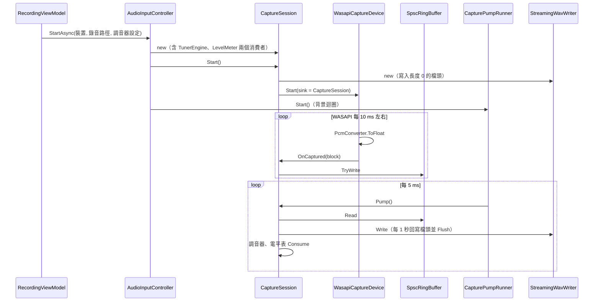
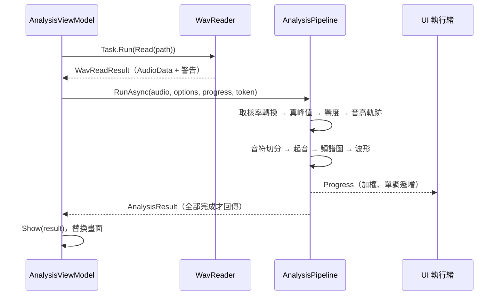
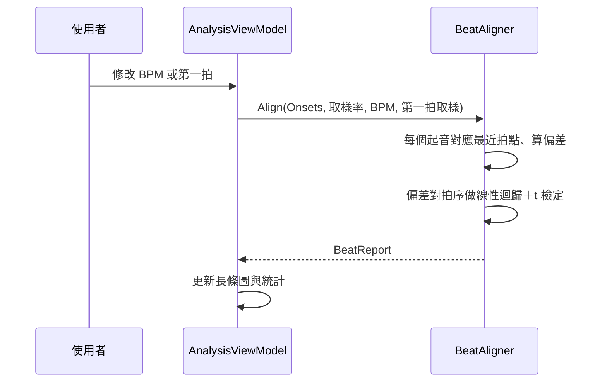

# 06 輸入／輸出介面與資料流

本專案是桌面程式，沒有 HTTP API，也沒有資料庫（05 章略過）。這一章改寫為：程式讀寫哪些檔案、從哪些裝置進出音訊、命令列參數，以及三條核心流程的資料流。

## 輸入／輸出一覽

| 介面 | 方向 | 格式 | 實作位置 |
|---|---|---|---|
| WAV 檔（分析來源） | 讀 | PCM 8/16/24/32、IEEE float 32/64、WAVE_FORMAT_EXTENSIBLE；單聲道或立體聲 | `src/PracticeMate.Core/IO/Wav/WavReader.cs` |
| 錄音檔 | 寫 | 32 位元浮點 WAV，58 位元組檔頭（RIFF + fmt 18 + fact + data） | `src/PracticeMate.Core/IO/Wav/StreamingWavWriter.cs` |
| 正規化輸出 | 寫 | 32 位元浮點 WAV，原取樣率與聲道 | `src/PracticeMate.Core/Analysis/Loudness/Normalizer.cs` |
| 設定檔 | 讀寫 | JSON，%LocalAppData%\PracticeMate\settings.json | `src/PracticeMate.App.ViewModels/Services/AppSettings.cs` |
| 報告 | 寫 | CSV（UTF-8 with BOM、InvariantCulture、RFC 4180 跳脫） | `src/PracticeMate.Core/Reports/CsvReport.cs` |
| 圖表 | 寫 | PNG | `src/PracticeMate.App/Services/WpfServices.cs` 的 `ChartImageExporter` |
| 錄音裝置 | 讀 | WASAPI 共用模式，裝置原生格式（通常 32 位元浮點） | `src/PracticeMate.Audio.Windows/WasapiCaptureDevice.cs` |
| 輸出裝置（節拍器） | 寫 | WASAPI 共用模式 | `src/PracticeMate.Audio.Windows/WasapiRenderDevice.cs` |
| 命令列 | 讀 | `PracticeMate.exe [檔案.wav]`：啟動後直接分析該檔 | `App.OnStartup()`（`src/PracticeMate.App/App.xaml.cs`） |

### 錄音檔格式的設計

錄音檔的檔頭是固定 58 位元組，比最小的 44 位元組多了 `fmt` 的 `cbSize` 欄位與一個 `fact` 區塊。浮點 WAV 依規範應帶 `fact` 區塊。

當機安全的關鍵在「檔頭什麼時候寫」：

1. 開檔時先寫入長度為 0 的檔頭。
2. 每累積 `headerUpdateIntervalFrames` 框（預設等於取樣率，即每 1 秒音訊），回頭改寫 RIFF、`fact`、`data` 的長度欄位，然後 `Flush(flushToDisk: true)`。
3. 正常結束時 `Complete()` 寫入最終長度。

更新時機用「取樣數」而不是牆上時鐘決定，所以行為是確定的、可以測試。讀取端（`WavReader`）遇到長度為 0 或超過檔案大小的檔頭時，改依實際檔案長度讀取，並在 `WavReadResult.Warnings` 加上中文提示。兩端配合，當機最多遺失最後一次更新後的資料。

> 📄 依據：README「錄音當機安全」；`docs/test-report.md` 端對端測試：強制結束程序後檔頭記載 3.01 秒、實際寫入 3.32 秒

### 設定檔欄位

| 欄位 | 用途 | 預設 |
|---|---|---|
| `A4` | 基準音（415–466 Hz） | 440 |
| `Transposition` | 移調樂器：`C`、`BFlat`、`EFlat`、`F` | `C` |
| `NoiseGateDbfs` | 調音器雜訊門檻 | −50 |
| `CaptureDeviceId`／`RenderDeviceId` | 裝置 ID；特殊值代表「跟隨系統預設」 | 跟隨預設 |
| `MetronomeBpm`／`MetronomeBeatsPerBar` | 節拍器 | 90／4 |
| `SpectrogramWindow`／`SpectrogramOverlap`／`SpectrogramLogFrequency` | 頻譜圖 | 2048／0.75／true |
| `NormalizationTargetLufs`／`TruePeakCeilingDbtp` | 正規化目標與真峰值上限 | −16／−1 |
| `RecordingFolder` | 錄音資料夾；null 為預設資料夾 | null |

設定檔損毀時不讓程式無法啟動：`JsonSettingsStore` 捕捉 `JsonException`，改用預設值並記在 `LastLoadError`，`App` 在主視窗顯示後再提示使用者。

### CSV 報告

三種報告：音符（序號、開始、結束、音名、MIDI、音準偏差）、節拍（拍序、拍點、起音、偏差、類別，最後附平均、標準差、趨勢、斜率、p 值）、響度。檔案以 UTF-8 with BOM 輸出，這樣 Excel 直接開啟時中文才不會變亂碼。數字一律用 `CultureInfo.InvariantCulture`，避免在使用逗號小數點的系統地區設定下產生錯誤的 CSV。

## 核心流程一：錄音

從按下「開始錄音」到檔案寫入的完整路徑。重點看擷取執行緒只做到 `TryWrite` 就返回。

停止時的順序：`RequestStop()` → 裝置停止並觸發 `Stopped` 事件 → `CaptureSession` 只記下停止原因（`Interlocked.CompareExchange`），**不在裝置的執行緒上收尾** → 下一次 `Pump()` 排空緩衝、`Complete()` 寫最終檔頭、轉為 `Stopped`。

裝置拔除的路徑和這完全相同，只是 `Stopped` 事件的原因是 `DeviceRemoved`。NAudio 的通知在 COM 執行緒上觸發，這個設計讓所有收尾工作都回到單一的消費者執行緒，不需要鎖。

> 📄 依據：`docs/design/architecture.md` §9 風險 R5「NAudio 裝置事件在 COM 執行緒觸發 → 事件只設旗標，由消費者執行緒收尾」

## 核心流程二：分析一個檔案

取消時 `RunAsync` 拋出 `OperationCanceledException`，`LoadAsync` 捕捉後只更新狀態訊息，`_original` 與畫面上的結果都還是上一次的，所以不會出現「波形是新檔、報告是舊檔」的半套狀態。

## 核心流程三：節拍報告即時重算

因為起音列表在分析時已經算好，這一步只是幾百個點的算術，可以在 UI 執行緒上同步完成，不需要背景工作。

## 核心流程四：節拍器輸出

節拍器走的是輸出方向：`WasapiRenderDevice` 在輸出執行緒上向 `MetronomeRenderer.Render()`（`src/PracticeMate.Core/Metronome/MetronomeRenderer.cs`）要資料。`MetronomeRenderer` 依 `MetronomeScheduler` 算出的拍點取樣索引，把預先合成好的點擊聲（`ClickSynth`）疊加到輸出區塊中；點擊聲跨越區塊邊界時會接續到下一個區塊。速度變更以 `RequestSettings()` 登記為「待生效」，到下一小節第一拍才套用。
