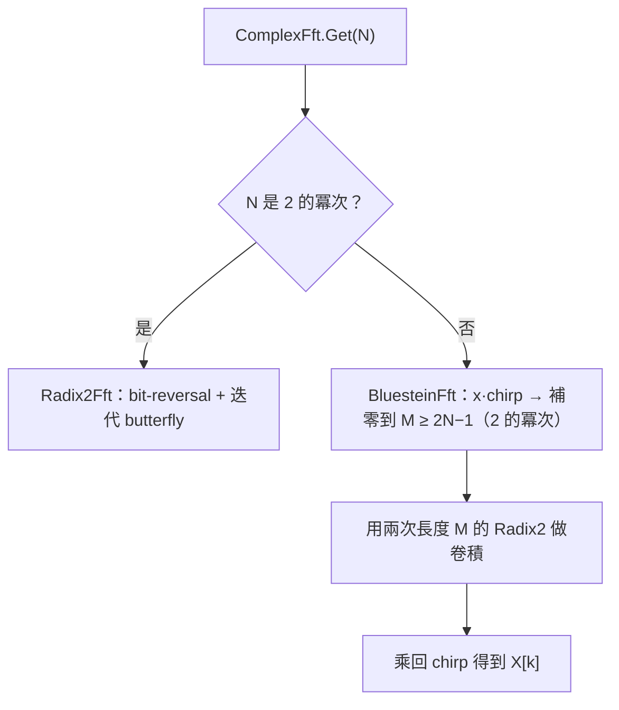
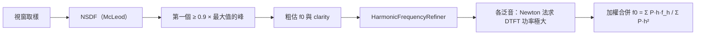
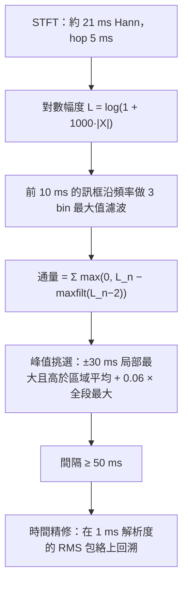
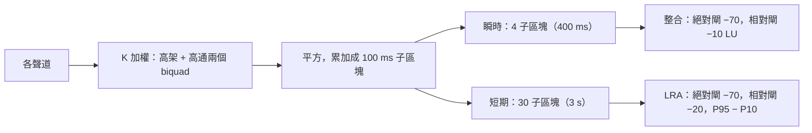

# 08 核心演算法

這是本專案技術含量最高的部分。規格禁止使用 DSP 套件，所以每個演算法都是自己寫、自己驗證。挑選標準是「最值得學、或踩坑最多」的八個。

閱讀建議：每節先看「要解決的問題」與「步驟」，有興趣再看邊界條件與替代做法。

---

## 1. 任意長度 FFT：基數 2 + Bluestein

**要解決的問題**：頻譜圖、音高（自相關）、起音都需要 FFT，而且驗收 #4 要求任意 N（1–10,000，含質數）都要精確（相對誤差 ≤ 1e-9·log₂N）。

**輸入／輸出**：長度 N 的複數序列 → 長度 N 的頻譜（`Span<Complex>` 就地轉換）。

**步驟**：



Bluestein 的核心恆等式：kn = (k² + n² − (k−n)²)/2，所以 e^(−2πi·kn/N) 可以拆成三個 chirp 的乘積，DFT 變成一次卷積，而卷積可以用任意長度（取 2 的冪次）的 FFT 計算。

**實作位置**：`src/PracticeMate.Core/Dsp/Fft/ComplexFft.cs`、`src/PracticeMate.Core/Dsp/Fft/RealFft.cs`。

**精度的兩個關鍵細節**：

1. **旋轉因子逐一直接計算**：`ComplexFft.Twiddle(k, n)` 先把 k 降到 [0, n)，再呼叫 `Math.SinCos`。常見的遞推寫法（w ← w·w₁）每一步都累積誤差，N 大時會超出 1e-9 的要求。
2. **chirp 角度先取模**：chirp 是 e^(iπn²/N)，n² 在 n = 10,000 時是 1e8，直接乘 π 後 sin/cos 的參數很大，會失去有效位數。改用 n² mod 2N 先降冪再計算。

**實數 FFT**：偶數長度時，把 N 個實數打包成 N/2 個複數（偶數項當實部、奇數項當虛部），做一次 N/2 點 FFT 後再分離，運算量約為直接做複數 FFT 的一半。

**複雜度**：基數 2 為 O(N log N)；Bluestein 為 O(M log M)，M ≤ 4N，常數約大 3–6 倍。計畫（plan）依長度快取在 `ConcurrentDictionary`，建立後不可變，可多執行緒共用；暫存區向 `ArrayPool` 租用。

**驗證**：與 `tests/PracticeMate.Testing.Reference/ReferenceDft.cs`（O(N²) 直接 DFT）比較，N 隨機取 1–10,000 的性質測試。

---

## 2. 音高偵測：MPM 選週期 + 泛音 DTFT 精修

**要解決的問題**：在 20 dB 雜訊下，對 55–1760 Hz、四種音色（含缺少基頻）測出 ≤ 1 音分的音高（驗收 #6）。1 音分約等於頻率差 0.06%：55 Hz 時是 0.03 Hz。

**輸入／輸出**：一個視窗的取樣（分析 4096 點 ≈ 85 ms；調音器 2048 點 ≈ 43 ms，皆指 48 kHz）→ `PitchEstimate`（頻率、clarity、RMS）。

**兩階段設計**：選對週期和量準頻率是兩件不同的事，分給兩個演算法。



**第一階段：McLeod Pitch Method**（`src/PracticeMate.Core/Pitch/McLeodPitchDetector.cs`）

- NSDF：n(τ) = 2r(τ) / m(τ)，r 是自相關（零填充的實數 FFT 計算），m(τ) = Σ(x[j]² + x[j+τ]²) 遞推。正規化後峰值在 0–1 之間，直接當 clarity 用。
- 選「第一個超過 0.9 × 全域最大值」的峰，而不是全域最大峰。週期為 T 的訊號在 2T、3T 也有幾乎一樣高的峰；選最大的容易選到 2T（低八度錯誤）。
- 以週期性判斷，所以缺少基頻（只有 2–6 次泛音）的音色也能找到正確的 f0。

**第二階段：泛音精修**（`src/PracticeMate.Core/Pitch/HarmonicFrequencyRefiner.cs`）

MPM 的峰值內插在雜訊下不夠準（原因見 11 章踩坑），所以頻率改用頻域估計：

1. Hann 視窗後做 FFT，在每個 h·f0 附近找頻譜峰值，保留最強的幾個泛音（低於最強者 −20 dB 的捨棄）。
2. 每個峰值以對數幅度的拋物線內插取得初始角頻率，再用 **Newton 法**求 DTFT 功率 P(θ) = |X(θ)|² 的極大值。對白雜訊中的單一弦波，這就是最大概似估計。
3. 各泛音的頻率 f_h 除以 h 都是 f0 的估計，以功率加權最小平方合併：f0 = Σ P_h·h·f_h / Σ P_h·h²。缺少基頻時 P₁ ≈ 0，自然不參與。

Newton 法需要 P 的一階與二階導數。程式以視窗中心為時間原點（u = n − (W−1)/2）一次累加 X、X′、X″，讓導數的數值範圍較小：

```csharp
// src/PracticeMate.Core/Pitch/HarmonicFrequencyRefiner.cs（節錄）
for (var n = 0; n < _windowSize; n++)
{
    var u = n - c;
    var t = _weighted[n] * z;
    x += t;
    x1 += t * u;
    x2 += t * (u * u);
    z *= rot;
}
// X' = −i·Σ u·a·e，X'' = −Σ u²·a·e
// P' = 2Re(X̄·X')、P'' = 2(|X'|² + Re(X̄·X''))
```

**參數**：分析用 6 個泛音、3 次 Newton 迭代；調音器用 4 個泛音、2 次迭代，以確保每 10 ms 區塊的運算 ≤ 1 ms（`TunerEngine` 建構子中的 `PitchDetectorOptions`）。

**複雜度**：NSDF 為 O(W log W)；精修為 O(H·I·W)（H 泛音數、I 迭代次數、W 視窗長度）。精修是整個分析最耗時的部分：每幀約 0.7 ms，10 分鐘音訊 60,000 幀，靠 `Parallel.For` 分攤。

**邊界條件**：
- 靜音或 RMS 過低 → `PitchEstimate.None`。
- 精修結果偏離粗估超過 3%（約 ±50 音分）的泛音直接捨棄，避免雜訊峰把結果拉走。
- Newton 二階導數 ≥ 0（不在極大值附近）→ 保留初始值。

**結果**：44.1/48/96 kHz × 41 頻率 × 4 音色，穩定段誤差中位數最差 0.39 音分、95% 最差 0.97 音分、八度錯誤 0%。

**替代做法**：YIN（與 MPM 類似，但沒有現成的 0–1 clarity）、純頻域峰值（缺少基頻時會選錯）、倒頻譜（cepstrum，解析度較差）。

---

## 3. 起音偵測：SuperFlux + 包絡回溯精修

**要解決的問題**：找出每個音開始的時刻，誤差 ≤ 10 ms，F 值 ≥ 0.95（驗收 #11）。這是節拍報告的資料來源。

**輸入／輸出**：單聲道取樣 → 起音的取樣索引列表。



**SuperFlux 的巧思**：一般的頻譜通量是「這一幀比上一幀多出的能量」。顫音讓諧波在頻率上來回移動，每次移動都像出現了新能量，造成假起音。SuperFlux 在比較前，先把舊訊框沿頻率軸做 3 bin 的最大值濾波（把舊頻譜「加寬」），小幅的頻率移動就不再被當成新能量。

**為什麼需要精修**：通量峰值落在起音的「中段」。對 30 ms 線性起音的管樂，通量峰值比真正的起點晚 10–15 ms，已經超出 10 ms 的要求。所以在 1 ms 解析度、10 ms 視窗的 RMS 包絡上，從峰值往回找「首次超過 底 + 10%×(峰 − 底)」的位置。

**精修的細節**（`OnsetDetector.Refine()`，`src/PracticeMate.Core/Analysis/Onsets/OnsetDetector.cs`）：前一個音的餘音可能和新音一樣大，所以：

1. **谷底**：通量峰值前 20 ms（但不越過上一個起音）到包絡最大值之間的最小值。
2. **包絡峰值**：從通量峰值**往後**找第一個比谷底高 3 dB 的局部最大，不往前找（前面是餘音），也不跳到後面拍頻造成的第二個峰。
3. **門檻**：至少高於谷底前 20 ms 內餘音的最大值，避免把餘音的起伏當起點；最多不超過 50% 上升量。
4. 上升不足 3 dB（連音、被餘音完全掩蓋）時沒有可靠的包絡起點，保留通量峰值的時間。

這四條規則來自驗收後的外部檢閱（11 章踩坑 F4）。原本的版本在 ±40 ms 內找包絡最大值，新音不比餘音大時會固定提前約 40 ms。

**包絡為什麼用 RMS 而不是逐格峰值**：低音的週期長於 1 ms 時，很多 1 ms 格子抓不到波峰，峰值包絡會鋸齒狀起伏，門檻交會點偏晚數毫秒。10 ms 的 RMS 視窗對 ≥ 100 Hz 的音是平滑的。

**複雜度**：STFT 為 O(F·W log W)，F 為訊框數，以 `Parallel.For` 分段。峰值挑選用前綴和計算區域平均，O(F)。10 分鐘音訊約 0.5 秒。

**邊界條件**：全段靜音（通量最大值為 0）→ 空列表；顫音不產生額外起音（測試 `Steady_tone_with_vibrato_has_no_extra_onsets`）。

**已知限制**：沒有音量起伏的連音只能靠頻譜變化偵測，時間誤差較大；新音只比餘音大幾 dB 時仍有 0.2% 超過 10 ms。

---

## 4. 速度趨勢：線性迴歸 + Student t 檢定

**要解決的問題**：判斷演奏者是否越來越快（漸快）或越來越慢。驗收 #12 要求 2% 的漸快可以被偵測。

**直覺**：如果速度穩定，每拍的偏差應該在 0 附近隨機跳動；如果漸快，起音會越來越早到，偏差隨拍序呈下降趨勢。所以問題變成「偏差對拍序的迴歸斜率是否顯著不為 0」。

**步驟**（`BeatAligner.Align()`，`src/PracticeMate.Core/Analysis/Beats/BeatAligner.cs`）：

1. 拍點 b_j = 第一拍 + round(j·60·fs/BPM)。每個起音對應最近的拍點，偏差 = 起音 − 拍點（正 = 拖拍）。距離超過 1/4 拍列為「拍點外」。
2. 偏差（ms）對拍序 j 做最小平方線性迴歸，得到斜率 b 與標準誤 SE(b)。
3. t = b / SE(b)，自由度 n − 2，雙尾 p 值由 Student t 分布求得。
4. p < 0.05 **且** |斜率| > 0.5 ms/拍 → 斜率 < 0 為漸快、> 0 為漸慢。少於 8 拍為「資料不足」。

第 4 步用兩個條件：只看 p 值時，拍數很多的錄音連 0.1 ms/拍這種聽不出來的趨勢也會被判為顯著；只看斜率則會被隨機誤差誤導。

**t 分布 CDF 的實作**（`src/PracticeMate.Core/Analysis/Statistics/StudentT.cs`）：沒有統計套件可用，所以自己寫。雙尾 p 值 = I_x(df/2, 1/2)，其中 x = df/(df + t²)，I 是正規化不完全 Beta 函數，以連分式（Lentz 法）計算，ln Γ 用 Lanczos 近似。

**複雜度**：O(n)，n 為拍數。

**已知限制**：規格要求「最近拍點」對照，累積偏差超過 1/4 拍後會對到錯誤的拍點（規格解讀 Q8）。

---

## 5. 響度：K 加權、閘控與 LRA

**要解決的問題**：依 ITU-R BS.1770-4 計算整合響度（LUFS），與參考實作差 ≤ 0.1 LU（驗收 #13）；EBU 3342 的 LRA 誤差 ≤ 1 LU（#14）。

**步驟**：



**值得學的設計：用類比原型重新設計任意取樣率的濾波器**（`src/PracticeMate.Core/Analysis/Loudness/KWeighting.cs`）

標準只給了 48 kHz 的係數。44.1 kHz 直接套用 48 kHz 係數，頻率響應會偏移。做法是把標準係數還原成類比原型參數（中心頻率 f₀、增益、Q），再以**預扭曲雙線性轉換**（K = tan(π·f₀/fs)）重新設計。驗證方式：用同一套設計程式在 48 kHz 產生係數，與標準表列係數相差 < 1e-6，證明參數還原正確。

**子區塊累加**：整合響度用 400 ms 區塊、75% 重疊。直接計算時每個取樣會被平方加總 4 次；先累加成 100 ms 子區塊，每個區塊只是 4 個子區塊的和，運算量降為約 1/4。子區塊邊界用 round(i·fs/10) 計算，對 44.1 kHz 這類不能整除的取樣率也正確。

**驗證的獨立性**：`tests/PracticeMate.Testing.Reference/ReferenceLoudness.cs` 用完全不同的方式計算：逐取樣直接套差分方程、每個 400 ms 區塊直接加總平方（不用子區塊），並由架構測試保證它不引用正式程式碼。兩個實作差 0.0000 LU。

**邊界條件**：全被閘掉（例如全靜音）→ `double.NegativeInfinity`，畫面顯示「—」；單聲道只計一次（不是 L、R 都算）。

---

## 6. 真峰值：4 倍多相過取樣 + 拋物線精修

**要解決的問題**：數位訊號的取樣點之間，重建後的類比波形可能超過取樣值（樣本間峰值）。驗收 #15 要求與理論值差 ≤ 0.3 dB。

**步驟**（`src/PracticeMate.Core/Analysis/Loudness/TruePeakMeter.cs`）：

1. fs < 176.4 kHz：用 Kaiser 視窗 sinc 做 4 倍多相 FIR 過取樣（每相 32 taps，`Vector<float>` SIMD）。
2. 4 倍過取樣對接近 Nyquist 的正弦最多低估約 0.7 dB，超過要求。所以對接近目前最大值（−0.9 dB 內）的過取樣局部極值，再做三點拋物線內插。只在少數點上執行，成本很低。
3. fs ≥ 176.4 kHz：直接取樣峰值（規格允許）。

**巧思**：原型濾波器的截止設在原取樣率的 Nyquist，使第 0 相恰好是單位脈衝。原始取樣點在過取樣後完全不變，所以真峰值永遠 ≥ 取樣峰值，「單一脈衝 a 的真峰值 = 20·log₁₀|a|」這個規格要求自然成立。

**為什麼在原始取樣率計算**：取樣率轉換本身是低通濾波，會改變樣本間峰值。響度可以在 48 kHz 算，真峰值不行（規格解讀 Q6）。

---

## 7. 節拍器：整數運算的拍點排程

**要解決的問題**：120 BPM 跑 1 小時不能漂移任何一個取樣（驗收 #9）。

**常見錯誤**：每拍累加 `interval = fs * 60.0 / bpm`。浮點累加 7,200 次會累積誤差；若 interval 不是整數還要每拍四捨五入，誤差更大。

**做法**：第 k 拍直接以整數計算，不累加：

```csharp
// src/PracticeMate.Core/Metronome/MetronomeScheduler.cs
/// <summary>round(k·60·fs / BPM)，以整數運算實作四捨五入（k ≥ 0）。</summary>
public static long BeatOffset(long k, int bpm, int sampleRate)
{
    ArgumentOutOfRangeException.ThrowIfNegative(k);
    var numerator = k * 60L * sampleRate;
    return ((2 * numerator) + bpm) / (2L * bpm);
}
```

(2a + b) / 2b 等於 a/b 四捨五入（round half up），全程 `long`，沒有任何浮點。這也是節拍器 BPM 限定為整數的原因（規格解讀 Q3）。

**速度變更**：新設定先存為 pending；排程到下一小節第一拍時，用舊速度算出這一拍的取樣索引，作為新區段的起點，k 歸零重算。每個區段內部仍然是直接計算、不累加。

**複雜度**：每拍 O(1)。

---

## 8. 波形抽樣：最小最大金字塔

**要解決的問題**：10 分鐘 48 kHz 有 2,880 萬個取樣，螢幕寬 1,500 像素。每次縮放平移都要算「每個像素欄涵蓋的取樣範圍內的最小值與最大值」，而且結果要與暴力計算**完全相同**（驗收 #18）。

**做法**（`src/PracticeMate.Core/Buffers/MinMaxIndex.cs`）：

- 第 c 欄涵蓋 [s + ⌊c·L/W⌋, s + ⌊(c+1)·L/W⌋)，以整數運算計算邊界（`MinMaxIndex.ColumnRange()`）。放大到一欄不足一個取樣時，取單一取樣。
- 預先建立分層金字塔：第 0 層每 64 個取樣一格，每往上一層再 ×64。
- 查詢一個區間時：頭尾不足一格的部分逐一掃描原始取樣，中間完整的格子直接用金字塔的值。

**複雜度**：建立 O(N)；每次查詢 O(64·log₆₄N)，與區間長度幾乎無關。區間很短（≤ 128 個取樣）時直接暴力掃描。

**為什麼結果完全相同**：最小值與最大值滿足結合律，任何切分方式算出來都一樣，不像平均值會有浮點捨入差異。這讓測試可以直接用 `Assert.Equal` 比較，不需要容許誤差。
