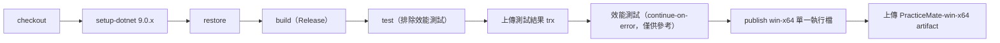

# 10 部署與環境設定

## 環境需求

| 項目 | 需求 |
|---|---|
| 作業系統 | Windows 10／11（WPF 與 WASAPI） |
| .NET SDK | 9.0.x（`global.json` 指定 `9.0.100`，`rollForward: latestFeature` 允許更新的 9.0 功能版本） |
| 音訊裝置 | 任一 WASAPI 共用模式可用的錄音裝置；節拍器需要輸出裝置 |
| 資料庫、外部服務 | 無 |

執行發佈後的單一執行檔不需要安裝 .NET（self-contained）。

## 本機啟動

```powershell
git clone https://github.com/hn83320589/PracticeMate.git
cd PracticeMate
dotnet build PracticeMate.sln -c Release
dotnet test  PracticeMate.sln -c Release --filter "Category!=Performance"
dotnet run   --project src/PracticeMate.App -c Release
```

啟動並直接分析一個檔案：

```powershell
dotnet run --project src/PracticeMate.App -c Release -- samples\01-走音音階.wav
```

重新產生範例錄音（會覆寫 `samples/` 下的檔案）：

```powershell
dotnet run --project tools/PracticeMate.SignalGen -c Release -- samples
```

## 設定項

程式沒有環境變數或連線字串。所有設定在使用者的設定檔中，由「設定」頁編輯，欄位見 06 章「設定檔欄位」。

| 位置 | 用途 | 必填 |
|---|---|---|
| %LocalAppData%\PracticeMate\settings.json | 使用者設定；不存在時使用預設值，損毀時使用預設值並提示 | 否 |
| `%UserProfile%\Music\PracticeMate\` | 預設錄音資料夾，可在設定中改為其他資料夾 | 否 |

唯一的環境變數只用於測試：

| 名稱 | 用途 | 範例 |
|---|---|---|
| `PM_PROP_SEED` | 只重跑性質測試的指定種子 | `<失敗訊息中的種子>` |

## 發佈

與 CI 相同的命令，產生單一執行檔：

```powershell
dotnet publish src/PracticeMate.App -c Release -r win-x64 --self-contained true -p:PublishSingleFile=true -o publish/win-x64
```

產物約 59 MB（含 .NET 執行環境與 WPF）。

## CI（GitHub Actions）

設定檔：`.github/workflows/ci.yml`。在 `push` 到 `main`、Pull Request、手動觸發時執行，runner 為 `windows-latest`。



設計重點：

- **測試結果在失敗時也上傳**（`if: always()`）：失敗時才最需要看 trx。
- **效能測試不擋綠燈**：runner 硬體不固定，數字只供參考；正式數據以 README 中的本機量測為準。
- `permissions: contents: read`：workflow 只需要讀取 repo，權限最小化。
- 建置開啟 `TreatWarningsAsErrors`，所以「CI 綠燈」同時代表沒有任何分析器警告。

README 頂端有 CI 徽章；`docs/test-report.md` 附有最近幾次 run 的連結。

## 常見問題

| 症狀 | 原因與處理 |
|---|---|
| 啟動時顯示「PracticeMate 已經在執行中」 | 單一執行個體限制（具名 Mutex）。關閉另一個視窗，或在工作管理員結束殘留的程序 |
| 啟動後提示「設定檔格式錯誤，已改用預設值」 | settings.json 損毀。到設定頁重新儲存即可覆寫 |
| 錄音頁沒有任何裝置 | 檢查 Windows 音效設定中的錄音裝置是否已停用；只支援共用模式 |
| 建置失敗，錯誤代碼為 CA 開頭 | 分析器警告被當成錯誤。修正程式碼；確實需要例外時用 `SuppressMessage` 並寫明 `Justification` |
| 本機效能測試比 README 慢很多 | 分析時間大致與 CPU 核心數成反比（README 數據在 24 邏輯處理器上量測）；另外 `dotnet test` 會平行執行各測試組件，單獨執行效能測試專案才準 |

> 📄 依據：前兩項來自 `src/PracticeMate.App/App.xaml.cs` 與 `src/PracticeMate.App.ViewModels/Services/AppSettings.cs` 的訊息；CA 分析器錯誤在開發中多次遇到（例如 commit `cce01a0` 關閉 CA1716）；最後一項來自 `docs/test-report.md` F2 的量測記錄。
> 🔍 推斷：「錄音頁沒有任何裝置」是常見情況的推測，開發過程中未實際遇到。
